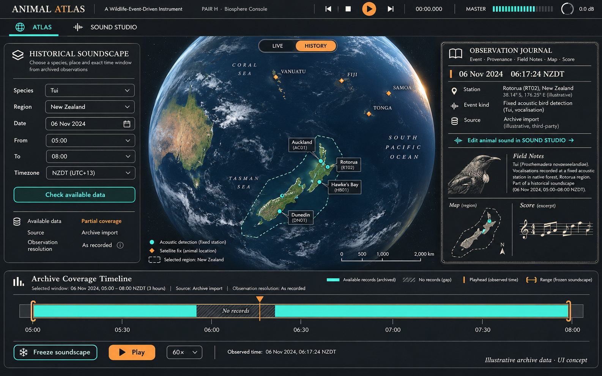
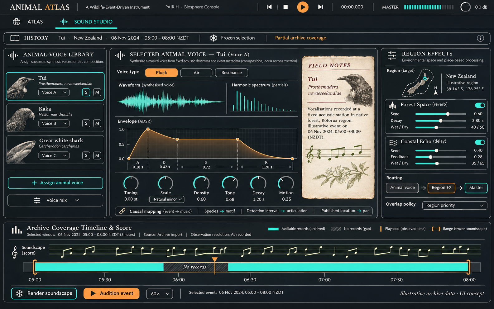

# Animal Atlas full feature brief and Direction H design handoff

Prepared 6 November 2026. Product name: **Animal Atlas**, working title. Selected visual direction: **H — Biosphere Console**, provisionally selected by the owner. Intended reader: the next UI/product design agent.

**Architecture update:** the owner requires portable C++ for production and permits React or WebUI for the UI. Recommended implementation: a C++20 core, thin JUCE standalone/VST3 wrappers, and a React/TypeScript interface with Three.js inside JUCE's embedded browser. React and a webview are complementary choices. The C++ event/replay core and read-only SQLite compatibility reader are now built/tested; the Python collector remains a temporary operational prototype. See `technical/CPP_REACT_INTEGRATION_NOTES.md` and `technical/contracts.ts` in the updated handoff package. No full JUCE/React host or audio engine is implemented yet.

Animal Atlas turns real wildlife tracking and detection events into an evolving musical composition. People explore activity on an atlas, choose animals and regions, collect events over hours, design the musical response, and replay or accelerate saved timelines. They can also compose from a selected historical period and species where genuine accessible data exists.

This brief describes the complete intended product. **The current build is a working local collection, event-session and replay-plan backend. The graphical interface, audible synthesis and regional audio effects have not yet been implemented.** A generated image is visual reference, not evidence of a working feature or connected source.

**Audit update:** the [revised engineering plan](../../docs/BUILD_PLAN.md) now defines delivery order and commercial-grade release gates; the [audit index](../../docs/audits/AUDIT_AND_REVISED_BUILD_PLAN.md) separates repaired defects from open work. This document remains the full product/design catalogue. The originally issued v1 ZIP is an immutable earlier handoff.

## 1. Owner decisions and scope

The following decisions should guide design work:

1. **Two main screens:** an Atlas for maps, incoming animal events and history selection; a Sound Studio dedicated to animal sound design and region-specific effects.
2. **Direction H for now:** a large spatial Earth view, dark slate panels, fine geographic labels, turquoise and warm-orange accents, and readable information around the map. Preserve the direction while improving usability.
3. **Zero cost is a hard requirement:** no paid software dependency, subscription, paid data API, paid map service, mandatory hosted backend or billing fallback. Public accessibility and permission to reuse data are separate questions.
4. **Real animal activity:** musical events must have inspectable links to genuine source records. Demo and imported data must be labelled.
5. **Worldwide ambition with a substantial NZ component:** broad source coverage is a product goal; today's implementation is NZ-focused and does not establish complete worldwide ingestion.
6. **Historical soundscapes:** select species, region and a date/time or time interval, check what data is available, and create a composition from that material. Do not imply arbitrary dates or species are supported.
7. **macOS first:** the owner's workflow uses Macs and Ableton. Standalone is the recommended primary application, with shared engines for an eventual VST3 companion. VST3 remains a product goal; AU and MIDI extensions are optional later work.
8. **Offline preservation:** a saved piece must remain useful without today's feeds or a network connection.

The exact synthesis algorithms, macro names, preset names, note mappings and effects palette remain design proposals. Labels such as Pluck, Air, Resonance, Forest Space and Coastal Echo in the mockups are audition directions, not settled DSP specifications.

## 2. Package contents and image interpretation

| File | Purpose |
|---|---|
| `images/01_H_Atlas_History.png` | Selected H Atlas concept, showing historical selection and coverage |
| `images/02_H_Sound_Studio.png` | Matching H animal-voice and regional-effects editor |
| `references/source-registry.json` | Dated source catalogue; implementation/access status is explicit |
| This Markdown file | Full product and UI feature reference |

The mockups were generated with image generation, drawing on the owner's globe command-display reference. The original inspiration GIF is not included in this package. The mockups' geography, animal positions, dates, statistics, notation, waveform drawings, source descriptions and controls are illustrative. Use proper cartographic data and real record metadata when implementing. In particular, a waveform drawing is not proof that original wildlife audio is available. Do not reproduce reference-image company logos, unrelated airport/business metrics or implied affiliations.

The paper-like Field Notes card inside H is a visual accent inherited during concept exploration. Its prominence can be refined; readable controls, map clarity and the two-screen workflow take precedence over reproducing it literally.

## 3. Principal user journeys

### Listen to incoming wildlife activity

Open Atlas, choose usable sources and species, enable listening, and see incoming records produce map pings and musical gestures. Inspect any gesture to understand the species, place, source, observation time and sound mapping. A quiet source can remain quiet; the instrument must not invent animal events.

### Collect and compose over hours

Choose a one-, two- or four-hour collection or a custom duration. Collect silently or collect while listening. Review the saved timeline, adjust eligibility and musical interpretation, accelerate it, and render a piece. Collection continues independently of an audio callback or open DAW project.

### Design animal voices and geographic sound

Select an event or animal in Atlas, open its corresponding voice in Sound Studio, edit synthesis and musical mappings, then assign sends or processing to a chosen geographic region. Return to Atlas without resetting the session, selection, playback position or sound settings.

### Create a historical soundscape

Choose a species or species set, a place and a historical date/time window. Discover usable archived records, see coverage and temporal precision, freeze the available material, and design a composition. Keep the requested interval distinct from the interval actually represented by data.

## 4. Shared navigation and session controls

- Persistent main navigation: **Atlas** and **Sound Studio**. Preferences, source setup and advanced diagnostics can be drawers or dialogs rather than extra primary pages.
- Shared active session, selected animal/species, region, filters, transport position and audio state across both screens.
- Clear **Live**, **Replay**, **History**, **Imported** and **Demo** context. History selects material; replay plays a fixed timeline. Do not use those terms interchangeably.
- Record, play/pause, stop, loop and an immediate all-notes/tails stop.
- Selected timeline mode: observation time versus arrival time.
- Playback speed, selected range, elapsed/remaining position and recording status/duration.
- Master level, output meter and a clear listening/audio-enable state.
- Save/open session and render/export entry points with visible progress, completion and failure states.
- A source connected indicator must be separate from the age of its newest observation.
- Keyboard access, meaningful focus states and accessible names for controls.

Transport, recording and listening are separate functions. A user may collect without hearing anything; stopping playback must not silently stop a long collection, and disabling a musical voice must not delete its recorded wildlife events.

## 5. Atlas screen feature list

### Geography and navigation

- Substantial world map or spatial globe, NZ focus, region zoom, saved regions and later geographic search.
- Large-map experience consistent with Direction H. A 3D globe is an aesthetic direction, not a requirement to use an expensive engine or sacrifice audio stability. A modest 2D/offline fallback is acceptable.
- Pan, zoom and reset view; optional selected-animal follow camera with gentle motion and an off switch.
- Clustering/aggregation at global scale, with real underlying events available for inspection.
- Distinct visual language for stationary detections, satellite/GPS fixes, receiver proximity detections, sightings and uncertain areas.
- Restrained new-event pings/ripples. Historical points do not pulse as fresh arrivals unless explicitly replayed.
- Optional measured individual trails; correct antimeridian wrapping and no fictitious interpolation across large time gaps.
- Uncertainty/detection radius and provider obfuscation retained. Do not infer hidden locations.
- Region outlines for filtering and geographic audio routing; clearly distinguish a region boundary from an animal path.
- Readable labels, colour-independent marker distinctions, reduced motion and restrained camera behaviour.
- Map licensing/attribution visible. No public-bundle map token reuse, paid tile dependency or bulk caching against a provider's policy.

### Selection and inspection

- Filter by source, species/group, known individual, deployment where useful, station, measurement type, region, confidence/quality and observation age.
- Favourites, source mute, species solo and selected-region activity.
- Clickable events showing species/common and scientific name, known identity, source attribution, measurement type, observation time, discovery/arrival time and accuracy/uncertainty.
- Confidence shown with its provider meaning; scores from different providers are not automatically comparable.
- A direct link from the selected event to its musical voice and mapping in Sound Studio.
- Show whether an event was sounded, grouped, filtered, deferred or suppressed, and why.
- Compact incoming event log, source activity list and optional selected-region summary.
- Raw records and endpoint details belong in an advanced inspector, not the normal performance surface.

## 6. Historical species soundscape feature list

This is an explicit owner requirement, extending the original live collection concept.

### Selecting historical material

- Select one or more species; optionally select a known individual or deployment when the data supports that identity.
- Select a geographic region using an existing region or a user-defined area.
- Select an instant/date or bounded observation-time range, with an explicit timezone. When a point in time is selected, show the actual search window or tolerance rather than pretending an event exists at that exact instant.
- Handle timezone conversion, daylight-saving ambiguities and source timestamp precision explicitly.
- Discover available zero-charge, permitted archives, saved local collections or authorised imported files.
- Show available dates/ranges, observation resolution, access requirements and source status before committing a selection.
- Preserve all source publication delays, redaction and uncertainty. An archive release date is not the animal observation date.

### Coverage and missing material

- Show the requested interval and actual available records separately.
- Distinguish **known coverage with no detections**, **missing records/collection coverage**, **access unavailable**, and **coverage unknown**.
- Do not infer a verified coverage gap merely because no animal records appear during an interval. Coverage needs evidence from the source or collector.
- Show coarse daily fixes as daily fixes; do not imply minute-by-minute historical movement.
- Make partial coverage and source limitations visible before freezing/rendering a soundscape.
- No fabricated events to fill historical gaps. Optional derived musical continuation, if later added, has its own label and controls.

### Freezing and composing

- Freeze selected event revisions and their order, query criteria, timezone, source precision, coverage metadata and provenance.
- Keep the original event material while allowing non-destructive selection changes and new musical interpretations.
- Use the same animal voice and regional-effects system as live sessions.
- Preserve the distinction between replaying an original performance and reinterpreting its event material.
- Render from the frozen selection offline; no request for future live data during rendering.

Current backend support includes observation-range snapshots of already stored records. Species-aware archive discovery, coverage UI, broad historical imports, synthesis and soundscape rendering are still to build. Arbitrary historical access is not established.

## 7. Sound Studio screen feature list

### Animal voice organization

- An animal/voice library with selection, mute, solo, gain and activity indication.
- Design sounds per species/group and, when individual identity is genuinely known, per individual. A microphone's species detection does not establish an individual animal.
- A proposed inheritance model is group defaults → species voice → optional individual override. Make any inheritance/override relationship understandable if adopted.
- Add/assign voices, audition a selected recorded event, and compare a voice change without waiting for the next live animal event.
- Preset save/load and clear separation between a sound preset and an event-containing session.
- Show selected historical context while editing a historical piece.

### Reference synthesis

- A small original instrument first: contrasting tonal pluck, sustained pad/air layer, resonant/noise texture and short bell-like voice are candidate directions.
- Per-layer tuning, envelope, gain, pan, filter and effect sends.
- Editable attack/decay/sustain/release or equivalent meaningful amplitude controls.
- Key/scale restriction, transposition, bounded register and optional chord context.
- Controlled polyphony, click-free changes, safe voice stealing, stereo output and sensible headroom.
- Clear voice and master meters, output trim, clipping indication and immediate panic/stop.
- Macro candidates: Density, Tone/Texture, Decay/Motion and Space. Assignments must be inspectable; the final names and mechanisms are not fixed.
- A modest delay and reverb for continuity; avoid a large effects suite before event/replay integrity and the reference instrument work.
- No promise of sampled wildlife audio unless that audio is separately available and permitted. Event-driven synthesis is the baseline.

### Event to music mappings

- Editable mappings independent of source adapters and rendering code.
- Inputs: species/group, known individual, source/station, region, published location, observation time, correctly derived local solar time if added, interval since events, provider-specific confidence and compatible measured movement.
- Outputs: trigger, pitch/scale degree, chord/phrase choice, layer/voice, velocity, duration, envelope, pan, filter, modulation and sends.
- Bounded ranges, curves, smoothing, deterministic seeded variation, transposition and stable species identities across restarts.
- Optional immediate triggering, deliberate timing quantisation and phrase scheduling; preserve original timestamps alongside transformations.
- Deterministic handling of simultaneous events, note releases and voice limits.
- Inspectable input → transformed value → musical action.
- Movement-derived speed/bearing only from compatible quality fixes for the same individual/deployment. No bird speed inferred between microphones.
- Location-to-pitch can be a preset experiment; it is not the whole musical design.

## 8. Region-specific effects feature list

This is an explicit owner requirement. Region processing should be a first-class part of Sound Studio, with its geographic targeting visible in Atlas.

- Select an existing geographic region or define an area, subject to an appropriate region editor.
- Name/save regions and display their boundaries, active effect assignments and priority.
- Target events using their published locations. Station detections belong to station/detection areas, not inferred individual positions.
- Define behaviour for uncertainty intersecting a boundary and for records without usable coordinates; show the chosen policy rather than assigning a false precise region.
- Assign regional effect chains/sends, with clear enable/bypass, send level and wet/dry controls.
- Initial effect candidates: reverb and delay; region names such as Forest Space and Coastal Echo are creative labels, not an ecological classification service.
- Clear routing from animal voice through regional sends/processing to master, retaining controllable direct sound as appropriate.
- Explicit overlap policy. The mockups suggest highest-priority region; blending or multiple sends are alternative design choices to evaluate.
- Smooth transitions when an event changes region or a user edits routing; define tail ownership and bypass behaviour.
- Region audition, per-region mute/solo where useful, and visible contribution to the selected event's sound.
- Save region geometry, targeting rules, assignments and parameters in the session/preset as appropriate.
- Handle regions crossing the antimeridian. Do not infer habitat, country or endangered-animal location from unavailable information.

These effects and their audio routing are planned, not implemented in backend v0.2.

## 9. Density, diversity and silence

- Master event-rate/density control plus per-source, species, station and individual limits.
- Preserve recorded events even when they produce no musical gesture.
- Stable duplicate suppression and optional repeated-call grouping with visible contributing counts.
- Quotas/weights so dense bird activity does not erase rare shark/turtle events.
- Provider-specific confidence/quality thresholds with understandable meanings.
- Burst modes: direct, capped, grouped, or scheduled into a chosen musical window; show the transformation.
- Strict event-driven mode that allows silence.
- Optional sustain/resonance mode that lets existing voices decay or evolve between records.
- Later optional generative continuation, clearly separated from measured events and separately controllable.
- Distinguish record count, eligible count, sounded gestures, groups and suppressed actions.
- Explicit high-speed overload behaviour. Preselect/freeze musical actions when reproducible rendering under overload is required.

High event throughput does not automatically make a good composition. Accelerated replay must communicate the effect of its density settings.

## 10. Collection, saved sessions and replay

### Collection

- Collect-only and collect-and-play modes.
- One-, two-, four-hour and custom duration workflows, with progress, stop and recovery.
- No DAW or open audio callback required for collection.
- Visible behaviour when closing the window, quitting, sleeping, disconnecting or resuming.
- An optional keep-awake control can be evaluated; it must not imply collection is possible during shutdown or loss of connectivity.
- Historical baseline imports do not flood the live instrument with old notes. Catch-up is explicit.

### Sessions

- Save/open sessions with fixed eligible event revisions, ordering, source provenance and query/selection settings.
- Snapshot mappings, transforms, voice routing, synth/effect parameters, region definitions, seeds and software/schema versions as those engines are implemented.
- Record performance control changes when live-performance reproduction is supported; final parameter values alone are insufficient.
- Bookmarks, selected time ranges, saved regions and non-destructive event selection.
- Restore when the collector is unavailable; portable bundles must not rely solely on absolute machine-specific paths.
- Interrupted collection must be labelled, with a defensible capture boundary rather than invented coverage.
- Storage use, retention preferences and clear admission-limit/truncation warnings; saved pieces protected from routine data cleanup.

### Timeline modes and transport

- Live arrivals: genuinely newly discovered eligible records.
- Observation timeline: order by the original observation times.
- Arrival timeline: reproduce how records were discovered/received, including batches.
- Accelerated replay: compress a selected timeline, for example four hours into four minutes at 60×.
- Scrub, range selection, zoom, seek, loop, bookmarks and adjustable playback speed.
- Speed changes preserve synthesis pitch unless an explicit pitch-changing mode is later chosen.
- Define note-duration scaling, quantisation, overlapping voices, seek/reset and effect-tail policies.
- Quick audition may reset voices/tails; faithful render/seek can require state restoration or pre-roll. Make the chosen behaviour clear.
- Never leave stuck notes on stop, seek, mute, disconnect or session replacement.

Event/mapping determinism is required. Bit-identical audio across platforms or future renderer versions is a separate claim requiring tests.

## 11. Export and import

- Target export: stereo WAV with declared range, sample rate, tail policy and progress/error reporting.
- Normalised event JSON/CSV, portable session bundles and attribution metadata.
- Optional generated MIDI where useful and supported; internal synthesis does not depend on MIDI output.
- Export event-time range separately from collection-time range.
- Render frozen sessions without network access and without changing pitch merely because event timing is accelerated.
- Do not export credentials or restricted raw provider payloads. A local archive format is not proof of permission to redistribute its contents.
- Import appropriately obtained CSV, JSON, GeoJSON or GPX where useful; preserve source/provenance, timestamps and measurement meaning, labelled as imported/replay material.
- Validate malformed files, schema versions, size bounds and integrity checks. Provide clear recovery/relink states.

Implemented now: local `.atlas.json` session bundle export/import. WAV, normalised CSV, generic telemetry-file import and MIDI are not implemented.

## 12. Source acquisition, identity and data truth

- Adapter interface for permitted polling, pagination and genuine streaming where supported.
- Conservative source-specific intervals, cancellation, timeouts, exponential backoff with jitter and Retry-After handling.
- Incremental watermarks, overlap/reconciliation windows, cursor recovery and stable deduplication.
- Independent raw source evidence and versioned normalised interpretations.
- Atomic persistence before dispatch, idempotent restart handling and a durable change log.
- Explicit correction revisions; corrections must not silently retrigger notes or mutate an existing frozen piece.
- Separate animal identity, deployment/tag identity and station identity. Retagged animals require evidence-backed reconciliation, not name matching alone.
- Validate timestamps, timezone, coordinates, suspicious future records and missing fields. Unknown remains unknown.
- Preserve uncertainty, provider obfuscation, location restrictions and sensitive-species policies.
- Store observation time, provider publication time if supplied, first-seen time and ingestion time separately.
- Distinguish sampling interval, upload interval, processing/publication delay and collector poll interval.
- Do not report publication delay as zero when the provider does not supply the evidence to measure it.
- Track technical status and permission/cost status separately. A source that becomes paid or inaccessible remains unavailable; no automatic purchase or hosted fallback.

Supported event meanings must include GPS/satellite fix, acoustic receiver proximity detection, acoustic species detection and human observation. Different measurements need different UI language and map treatment.

## 13. Source catalogue and honest support claims

The included registry preserves 30 candidates. Only the following acquisition paths are implemented in the current backend:

| Source | Current implementation | Important limit |
|---|---|---|
| BirdWeather | Public GraphQL acoustic detections; default NZ window; unauthenticated requests tested | Rolling observation windows, pagination and late uploads do not establish complete history. Commercial reuse remains unresolved. |
| NZ Great White App / Sustainable Oceans Society | Public-map latest-position snapshots | Not full track history; intermediate fixes may be missed. Provider subjects are not yet reconciled to animals/deployments. Reuse/access expectations remain unresolved. |

Current defaults are at least 60 seconds between BirdWeather polling waits and 900 seconds for shark snapshots, plus fetch duration/jitter. This is polling-based near-real-time discovery, not guaranteed instantaneous provider push.

Candidate priorities include concrete accessible Movebank studies, Robots4Whales, NSW/WA SharkSmart, Sharktivity, OCEARCH, Shark Research Foundation and Dorsal. NZ expansion includes albatross, gannet, petrel and turtle projects and review of Whale Watch Kaikoura's event meaning. Further leads include turtle trackers, Monterey Bay white sharks, Pacific Whale Foundation, iNaturalist and eBird. Motus, polar bears, BirdLife, OTN and OBIS may be archive/research candidates depending on actual access and delay.

No candidate logo or name implies working integration, genuinely current records, affiliation, independent upstream origin or free redistribution rights. Generic platform access is not permission to every study. Verify overlapping providers before counting records as independent streams.

The UI needs states for research lead, documented route, endpoint tested, freshness confirmed, permission confirmed, archive-only, blocked and unavailable. Keep these in source management; the normal musical surface can use simpler accurate summaries.

## 14. Source health and activity analytics

- Last attempted/successful fetch, last error, connection state, schema errors and retry state.
- Newest observation age independent of successful connection.
- Coverage/gap and pagination-limit indications; unknown completeness stays explicit.
- Unique events/hour, species, individuals and stations, with event type retained.
- Event-active dates with explicit calendar timezone.
- Inter-event statistics, quiet gaps, batches and observation-to-discovery age where meaningful.
- Measured publication lag only when supported by timestamps/evidence.
- Activity before and after musical selection/grouping/density limits.
- Aggregate inter-event statistics derived from the merged timeline, not averages of per-animal averages.
- Avoid presenting detection counts as individual-animal abundance or population estimates.

## 15. Required UI states and interaction quality

Design more than the populated happy path. Include:

- First launch, source setup, no sources selected, and no credentials where a free permitted source requires them.
- Connecting, records arriving, healthy connection with old observations, quiet source and repeated successful empty responses.
- Disconnected/offline, cached session available, failed/retrying source and paused collection.
- Recording, duration reached, early stop, interrupted/recovered recording and storage-limit warning.
- Empty library, empty replay, missing/corrupt bundle and unsaved sound changes.
- History date unsupported, coverage unknown, partial archive, no matching species/region/time and valid coverage with no detections.
- Loading a large selection, cancelling, rendering/exporting, success and failure.
- Audio off, no output device, muted/solo state, overload/voice stealing, master clipping and panic.
- Source permission/cost unavailable and imported/demo context.

Use readable text, keyboard navigation, visible focus, meaningful meter/control labels and colour-independent event distinctions. Offer reduced motion. Avoid endless decorative rotation, gratuitous camera movement and dense dashboards without a musical purpose.

Normal UI copy should explain the user's action and data meaning. Endpoint URLs, JSON, database revisions and queue diagnostics belong in advanced tools.

## 16. Architecture constraints relevant to design

- Collector and persistent event store are independent of audio processing and eventually the DAW process.
- Production target: portable C++20 with SQLite and platform/network adapters. Current operational collector: Python 3.9+ standard library and local SQLite, retained during migration. First native milestone: event/replay core and read-only session CLI, with no Python runtime dependency. No mandatory account or paid service.
- A versioned authenticated loopback JSON API exposes source status, events, durable change batches, sessions and replay plans.
- Current routes cover `/v1/status`, `/v1/events`, `/v1/changes`, `/v1/sessions`, session recording/snapshot/stop and session event/timeline reads.
- Consumer acknowledgements use store identity plus revision sequence; reconnect delivery is at-least-once and consumers deduplicate.
- The current API rejects browser Origin requests. A browser-based design prototype will require a deliberate safe integration bridge; do not put backend bearer tokens into page URLs, public JavaScript bundles or screenshots.
- No network, database access, JSON parsing, logging, unbounded allocation or blocking locks on an audio callback.
- Bound event transfer, caches, raw retention, voice count and admitted work; expose omissions/grouping honestly.
- Use monotonic scheduling and UTC record timestamps; recover sensibly from sleep, system clock changes and network loss.
- Map rendering and animation must not compromise audio deadlines. Profile globe/terrain/shader choices rather than assuming they are cheap in a DAW.
- Keep collection, sound presets and fixed event-containing sessions distinct in the architecture and UI.

## 17. Eventual VST3 companion

- Reuse the proven event interpretation, mapping, timeline and synthesis engines.
- Connect to one shared collector with per-instance subscriptions and reconnect handling; avoid multiple plug-ins independently hammering sources.
- Host tempo/transport, automation, sample-rate and block-size changes, state restoration and defined stopped-transport/free-running behaviour.
- Network-free offline bounce from a frozen session.
- Portable asset/state recovery and a reasonable DAW state size; no absolute path as the only recovery method.
- Compact, resizable companion interface appropriate to a DAW, with standalone retaining full atlas/library management.
- Actual Ableton host tests required before claiming host support. AU and MIDI extensions are later candidates.

No plug-in, audible standalone synth or native audio bridge exists yet. Do not treat a mockup's audio controls as implemented.

## 18. Implementation status and build priorities

| Area | Current state |
|---|---|
| Two real acquisition adapters and SQLite ingestion | Implemented and directly tested for the bounded local research scope described above |
| Deduplication, baseline suppression, revisions, durable live change API | Implemented |
| Recordings, immutable snapshots, interruption recovery and local session bundles | Implemented |
| Observation/arrival replay plans and rational speed changes | Implemented as data scheduling/oracle logic, not audible transport |
| Graphical atlas and Direction H interface | Design only |
| Species-aware historical archive discovery/coverage workflow | Planned; local observation-range snapshots provide a partial foundation |
| Animal synthesis, voice editing, mapping editor and density/diversity transforms | Planned |
| Region effects and audio routing | Planned |
| WAV render, complete musical-performance snapshots, VST3/AU | Planned/later |

Post-audit validation: 50 Python tests and 17 native cases passed, with the native cases checked in Debug, Release and ASan/UBSan builds. Earlier bounded real collection, recording and offline event-session restoration were verified. These are not GUI, audible synthesis, multi-day soak or DAW tests. No claim is made about the owner's current collector state by this package.

Prototype limits: eight active recordings; up to 50,000 events and approximately 63 MiB event material per saved session; 64 MiB bundle limit; 512 MiB collection admission soft limit. Truncation is explicit. These are current backend bounds, not permanent product design requirements. Retention/pruning, full database backup tooling and production packaging remain outstanding.

Recommended delivery order:

1. Close native verification/schema/provenance gaps, then prove one bounded mapped voice and offline WAV render.
2. Connect the two-screen shell, native bridge, event inspector and truthful local species/region/time workflow; design may proceed alongside the first audio slice.
3. Complete backup/restore, paginated library, native collector parity and controlled writer handover.
4. Add the small contrasting voice palette, editable mappings, density/diversity, regional effects and full musical-performance recall.
5. Qualify devices, accessibility, packaged offline operation, source/dependency rights and the zero-cost distribution route before claiming a release candidate.
6. Add VST3 and further permitted source/archive/platform coverage through their own qualification gates.

## 19. Acceptance criteria for design and implementation

- A user can identify which screen they are on, which session/material is active, whether they are hearing live or replayed material, and which time basis applies.
- Selecting an event opens the correct species/individual voice without losing the map selection or transport state.
- Every sounded gesture can reveal its source event and mapping; grouped gestures retain contributing records.
- A stationary detector never becomes a fictitious individual journey, and unknown identity/accuracy is not presented as known.
- Historical selection shows species, region, timezone, requested range, actual material and coverage status before freezing.
- A historical gap is not silently filled with fabricated wildlife events or mislabelled as measured animal silence.
- Region effects show their geographic target, routing and overlap policy, and remain understandable for uncertain or missing locations.
- A high-volume source or accelerated timeline does not overwhelm the audio engine without visible admission/grouping information.
- Baseline/restart/correction behaviour does not retrigger already ingested material as new live events.
- Saved material reopens and renders without live connectivity; source updates do not silently change a frozen piece.
- Stop/seek/mute/reset cannot leave stuck notes; effect-tail behaviour is deliberate.
- Main workflows remain readable and operable without tiny text, hover-only explanations, colour-only states or mandatory animation.
- No chosen dependency, source route, map service or hosting requirement violates the zero-cost constraint.

## 20. Suggested output from the UI design agent

Provide editable designs for the Atlas and Sound Studio, including a live Atlas state and a historical-selection state. Preserve a common session/transport system between pages. Include source setup/health, an event inspector, animal voice editing, regional-effects targeting/routing, library/open/save/export, and the empty/quiet/offline/partial-history states.

Use the existing images as direction rather than pixel-perfect specifications. Supply a reusable visual system, navigation/state model, component/control states, responsive/resizable behaviour, and an implementation handoff explaining how user actions map to backend concepts. A desktop baseline around 1440 × 900 is a proposed design starting point; test readable smaller/resized layouts rather than treating the generated image size as a fixed requirement.

Keep unknown product decisions explicit: final synthesis palette, macro assignments, detailed region-overlap/tail policies, archive-provider availability, audio/device integration and map engine selection. Visual polish must not imply those engineering/access decisions are solved.
