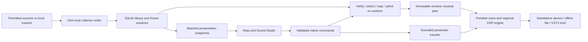

# Animal Atlas — revised product and engineering build plan

Audit baseline: 6 November 2026 UTC; final consistency review: 7 November NZDT. Status: **development plan, not a release qualification**. This replaces earlier suggested delivery sequences and unqualified estimates. It incorporates three GPT-6 Astra audits, isolated counterexamples, the owner's portable-C++ and zero-cost requirements, and Direction H. Findings and remediation evidence are indexed in [the audit](audits/AUDIT_AND_REVISED_BUILD_PLAN.md).

The 0.10.0 standalone scopes Live to observations made since Collect, tracks per-species counts across the session and keeps the species ranking scrollable within the window. [Playback visualization concepts](../design/live-session-concepts/README.md)

The 0.9.0 standalone added Smoothed live playback, which retains a note for each eligible detection through collection bursts and uses observation or source timing to space them. [Smoothed Live qualification](../evidence/smoothed-live/qualification.md)

The 0.8.0 standalone introduced musical arrangement for new detections, geographic voice routing, a measured output meter and per-observation outcomes alongside Direct playback. Saved-library browsing, freezing/import and the initial Live path have also shipped on beta-1. [Current standalone workflow](STANDALONE.md) · [Musical Live qualification](../evidence/musical-live/qualification.md)

Implementation update, 7 November: [M1 verified native data pieces](milestones/M1_VERIFIED_PIECE.md) is complete on beta-1 in the qualified macOS fixture environment. [M2 first-sound engineering](milestones/M2_FIRST_SOUND.md) supplies numeric actions, partition-independent admission, a bounded native voice renderer and offline WAV export. [Experimental native UI playback](milestones/UI_NATIVE_PLAYBACK.md) now adds saved-piece preparation, explicit audio enable and acknowledged transport through a separate optional JUCE output executable; see the [native playback contract](milestones/NATIVE_PLAYBACK_CONTRACT.md). Eight CTest suites pass in Debug, Release and ASan+UBSan, including 13 runtime and nine protocol groups; an independent ThreadSanitizer run passes all 13 runtime groups. Exact identities and results are in [playback evidence](../evidence/native-playback/). A [brief actual default-output callback smoke](../evidence/native-playback/device-smoke.json) passed at 48 kHz/-18 dB after startup and device-list-policy repairs, covering silent enable, advancing playback, pause/seek/resume/stop and clean EOF shutdown. Listening, device changes/recovery, sustained operation and callback deadlines remain unqualified. The real-JUCE prepare-only regression is separate and never enables output. Human listening, packaged webview, whole-product resource and platform gates remain open, so whole M2 is not complete. The H2 Atlas/Studio and separate demo remain an early M3 slice; [frontend readiness](milestones/FRONTEND_INTEGRATION_READINESS.md) preserves the earlier data-only checkpoint.

Native voice update, 7 November: [Sound Studio editing and saved definitions](milestones/UI_NATIVE_VOICES.md) extends the first struck tone with Transpose, Attack, T60 Decay and per-species Gain. Acknowledged edits affect new notes; explicit Save writes a separate preset sidecar with revision-checked updates, and Revert reloads durable state. The [host](milestones/NATIVE_VOICE_HOST_CONTRACT.md), [DSP](milestones/NATIVE_VOICE_DSP_CONTRACT.md) and [store](milestones/NATIVE_VOICE_STORE_CONTRACT.md) contracts define the limits. Current native qualification is 11 Debug/ASan+UBSan suites and 12 Release suites, plus 20 ThreadSanitizer groups; [voice evidence](../evidence/native-voices/) supersedes earlier counts for this revision. The real JUCE host is tested without enabling output; previous physical-output receipts remain historical. This completes the bounded editing/definition-save integration, not complete soundscape recall/export, the full voice palette or whole M2 acceptance.

Current composition/regional update, 7 November: [composition](../evidence/composition/qualification.md) now adds deterministic species phrases, musical controls and schema2 scene capture; [regional mixing](../evidence/spatial/qualification.md) adds up to eight authored geographic regions, stereo placement, normalized echo/comb ambience and schema3 persistence. Complete voices, composition and ordered regional settings can be recalled and rendered without the source library; schema1/2 hashes and audio are preserved. These are completed bounded engineering milestones within M2/M3/M5, not whole-product acceptance. Earlier paragraphs and evidence directories are historical checkpoints. Exact current checks, resource results and remaining listening/device limitations are in the linked evidence, not the earlier suite counts.

Standalone update, 7 November: the [packaged beta milestone](milestones/STANDALONE_PLAN.md) implements an embedded local WebKit UI, app-owned data, verified scene import, WAV save, output selection/buffer preferences and quiet manual recovery. See [qualification](../evidence/standalone/qualification.md) for the exact build and actual packaged-app evidence. Earlier separate-host and unimplemented-packaging statements below describe their historical checkpoints. This local arm64/macOS15 beta is not a notarised release or a physical device/DAW qualification.

Owner playback clarification supersedes effect-skill timing rules throughout this plan: the software generates music and offline audio; it does not process live input. Field live-input latency budgets and synthetic microsecond deadlines are not acceptance gates or limits on musical scope. Keep ordinary playback safety, sustained progress, resource ownership, responsiveness and evidence of actual listening quality.

## 1. Product objective and authority

Build a musical instrument that makes real wildlife activity understandable and musically useful. A person must be able to inspect an event on the Atlas, hear its musical interpretation, edit that interpretation in Sound Studio, shape geographic effects, and preserve a composition that can be reopened without its original feeds. Historical composition must use actual available material for a selected species, region and interval.

Commercial-grade means dependable recall, controlled sound, clear interactions, safe resource use, recoverable data and credible support claims. It does not require charging money or choosing a proprietary licence. The hard owner constraints remain zero monetary cost for required software, collection, services and dependencies; portable C++ production logic; two primary screens; and truthful provenance. The full [feature brief](../deliverables/Animal_Atlas_Direction_H_Design_Handoff/ANIMAL_ATLAS_FULL_FEATURE_BRIEF.md) remains the product catalogue. This plan assigns delivery gates rather than deleting those ambitions.

Distinguish owner decisions from engineering recommendations. Standalone first, JUCE wrappers, React/TypeScript/Three.js, provisional resource ceilings and the release cut below are recommended implementation choices. JUCE version/licence, public distribution route, exact sound identity and final supported-platform matrix still need recorded decisions. Do not silently turn suggestions into claimed owner approvals.

## 2. Baseline: what exists and what does not

| Area | Verified baseline on this Mac | Missing production capability |
|---|---|---|
| Acquisition | Python polling of bounded NZ BirdWeather detections and Great White App latest-position snapshots | Cleared release permissions, comprehensive archives, long-duration qualification, native acquisition |
| Data library | SQLite revisions, baseline suppression, transactions, source status, change cursors | Backup/restore tooling, retention, robust rejection quarantine, complete coverage evidence |
| Sessions | Verified data windows plus immutable native soundscapes containing source records, voices, composition and regions; independent recall/render | In-app history discovery/freezing and general native write sessions |
| Native core | C++20 verified timelines, deterministic phrase compilation, six synthesis characters, eight regional stereo buses, echo/ambience, immutable WAV jobs, voice/scene stores and optional JUCE output | Native acquisition/writer, broader voice models, richer diffusion and qualified device/platform lifecycle |
| UI | H2 Atlas/Studio, acknowledged native transport and eight voice controls, composition editor, ordered geographic effects editor/map preview, full scene save/recall/WAV jobs; separate labelled demo | Packaged JUCE webview, runtime master editing, accessibility and graphics qualification |
| Release | Self-contained local macOS15/arm64 beta with bundled WebKit UI, dependency/signature checks and independent-copy smoke | Public distribution route, physical-device/listening acceptance, plug-in, installers and clean-machine support |

Historical M1 qualification recorded 70 Python tests, 18 core cases, SHA vectors and 18 storage tests; initial UI integration recorded seven native UI and seven client/store regressions. Those are historical counts. The preceding native playback checkpoint passed eight CTest suites each in Debug and ASan+UBSan, and nine in the optional Release audio-host build; runtime/protocol tests and the independent ThreadSanitizer run are indexed in `evidence/native-playback/`. The earlier UI checkpoint passed 13 unit tests and nine browser groups (`evidence/m2-audio/globe-checks.json`); current playback UI evidence is recorded separately in `evidence/native-playback/ui-checks.json`. Earlier real-library parity compared 18,992 scheduled events over 16 scenarios. That historical parity evidence does not replace clean-checkout storage fixtures, integrity tests, audio tests or DAW qualification. Native offline audio and experimental capability-backed saved-piece playback are implemented and tested with synthetic fixtures. Human listening, sustained device/recovery tests, complete-product CPU qualification and working VST3 remain outstanding.

Two contained repairs are complete: interrupted recordings are recovered under writer ownership before `collect-once` acquires material; timeline sorting no longer constructs owning string tuples per comparison. Project warnings now fail builds by default, including test targets. Open audit findings remain open until their own acceptance tests pass.

## 3. Release cut and scope control

The first internal slice, **one verified saved session → one mapped native voice → offline WAV**, is implemented and extended to experimental native UI playback. The optional command-line host remains available; the new local standalone embeds the native instrument and production UI in one desktop app. Native playback uses fixed -18 dB master attenuation. Voice editing/modulation, composition, bounded regional effects and asynchronous UI WAV jobs are implemented. Live sonification and runtime master editing remain unsupported. The launcher/corpus and new playback path still need human listening and device qualification before whole-M2 acceptance. This first tone/resource setting does not limit the complete synthesizer palette, species/individual mappings, regional effects or historical composition.

The first release candidate should include the two H screens, an event inspector, permitted source connection or clearly labelled local import, collection/recording, species and local historical selection, a small contrasting voice palette, bounded mappings/density, regional routing, modest delay/reverb, stereo rendering, portable musical sessions, backup/restore and ordinary device handling. Quality gates apply to the complete supported workflow. If no default live source is cleared, an import-only build must be labelled accordingly; it does not fulfil the live-data release promise.

Later gates cover broader verified archives and geography, richer voice models, phrase/chord tools, advanced effects, VST3, Windows and additional formats. AU, MIDI export/input extensions, sampled wildlife audio, automatic ecological interpretation and scientific analytics remain optional separate proposals. Neither mockup labels nor a source catalogue imply implementation. Every added feature needs a user outcome, resource cost, persistence semantics and a release test; otherwise it stays in the catalogue.

## 4. Standalone, plug-in and architecture

Use the standalone as the primary product: it owns library management, permission-aware acquisition, historical discovery, long collections, backup and the full Atlas. A DAW is an unsuitable owner of continuous collection because projects close, hosts suspend processing and multiple instances can multiply network load. Add VST3 as a companion using the same portable mapping/DSP engine and frozen sessions. The plug-in must remain useful without a collector or connection.

The recommended arrangement is portable C++20 libraries behind narrow adapters. The core owns validated events, sessions, mappings, action compilation, rendering and DSP. SQLite, networking, OS discovery, files and devices remain outside the pure core. JUCE owns the desktop/audio/plug-in boundary if its pinned licence route is accepted. React/TypeScript owns controls and view state; Three.js supplies optional globe rendering in the embedded browser. A webview and React are complementary. Do not maintain a second browser audio engine or a second standalone host stack without an actual requirement.

Keep the collector isolated from audio failures. A single writer per library owns acquisitions and migrations; plug-in instances have independent sound state and subscribe through authenticated native IPC. Service disappearance changes source status without blocking processing. Initially retain the operational Python collector while the native reader and first instrument are proved. Port it once its replacement passes semantic, recovery and controlled-handover gates. Python, Node and development web servers must not be required by the final packaged product.

## 5. Data contracts, source access and ecological truth

Retain the live listening/detection stream and prioritise genuine individual-animal location tracking for other streams. Movebank historical-package preparation is an offline contract pilot; generic GBIF occurrence work is optional/deferred. [Pilot review](../data-pilots/REVIEW.md) does not activate a source or apply its proposed reliability patch. Never impose station-detection semantics on animal fixes or fabricate individual/deployment identity.

Maintain a versioned source ledger with endpoint/version, authentication, cost, permitted uses, attribution, redistribution/storage conditions, polling limits, archive bounds, timestamp precision, location meaning and date last verified. Technical access, free access and reuse permission are separate fields. Current adapters remain research connectors until release permissions are established. No paid fallback, bypassed access control, credential scraping or implied partnership is allowed.

Use one shared event specification and positive/negative fixture corpus across Python migration and C++. Validate JSON types as well as values and cross-field meaning. Include namespaced provider event/revision IDs; source; observation, publication if available, first-seen and receipt time; species identity/taxonomy version; station versus individual versus deployment; coordinates and uncertainty; source-specific confidence; original precision and provenance. Unknown remains unknown. A microphone detection is a species event at a station, not a tracked individual. Latest shark fixes are snapshots, not reconstructed full tracks. Derive movement only from compatible fixes for the same evidenced individual/deployment and acceptable intervals/accuracy.

Adapters must have bounded response bytes, decompression, pages, records, requests and duration; cancellation; verified TLS; explicit allowed destinations; no credential forwarding on redirects; exponential backoff with jitter and `Retry-After`; and a circuit state visible to the user. Respect published limits and the existing conservative defaults. Pagination completion, capped results, invalid rows, repeated cursors, late pages and provider corrections need distinct outcomes. A changed query/scope must restart baseline eligibility, not flood the live instrument.

Commit revision, latest pointer, checkpoint and poll result atomically. Duplicates create no new gesture; corrections do not masquerade as fresh animal activity. Advancing checkpoints after partial failure must not skip unseen data. Define provider ID reuse and deletions explicitly. Keep parsers tolerant only where the schema permits; bounded quarantine with redacted reason/raw evidence supports later repair. A schema drift alarm must stop misleading output rather than quietly accepting a new meaning.

Expose source freshness using observation age, last successful retrieval, polling interval, latency and coverage state. “Real time” in this product means best-effort polled arrivals, with visible ages; it does not promise instantaneous telemetry or continuous global visibility. Track unknown downtime and capped pages. A successful empty request proves only what that query and source can establish. It does not prove no animals were present.

## 6. Historical composition and geographic semantics

Historical selection is a capability-driven workflow: choose source/species, region, requested point or half-open interval and display timezone; inspect available material and coverage; preview; then freeze. A point in time must expand to a clearly stated search window/resolution when the provider does not supply instantaneous observations. Store the original request and actual returned extent separately. Do not interpolate extra animal events across gaps or claim continuous positions from sparse fixes.

Local collected records provide the first historical workflow. A remote archive is added only after confirming a zero-charge permitted route, range/volume limits and reproducible query semantics. A catalogue entry is not an archive connector. Support date-only and coarse timestamps honestly: never invent second-level precision. Preserve UTC internally plus original precision/timezone context. Resolve ambiguous/nonexistent DST times visibly. Treat observation-order reconstruction and arrival-order reconstruction as different timelines.

Choose and version the playback-window policy, not just the query. The recommended historical observation-order default preserves the entire requested half-open interval, including leading/trailing gaps and an empty selection; an explicit trim-to-material option saves different bounds. A point query uses its disclosed expanded interval. An empty four-hour selection can therefore preview four hours of silence without asserting ecological silence. M1 now implements and seals this policy: bounded snapshots preserve the requested interval by default; explicit trim retains material extent. Empty/leading/trailing/truncated fixtures and native/Python timings are verified before the history UI relies on them. Arrival-order playback uses separately defined receipt bounds rather than reinterpreting an observation-time query as arrival time.

Freeze the exact revision policy: for example, latest known revision at freeze time, or an explicitly supported as-known-at cutoff. A provider correction must not mutate an existing piece. Store query, source versions, species/taxonomy selection, geographic definitions, requested bounds, returned bounds, coverage evidence, gaps, truncation, seed and software/mapping versions in the session. Missing source coverage, capture truncation and musical omission are three different conditions.

Compute regions off the audio thread. Define polygon version, coordinate reference system, holes, boundary rule, overlap priority, antimeridian handling and missing/uncertain-location policy. Do not animate a stationary detector into a journey. Prefer explicit neutral routing or uncertainty-aware choices over false precision. Map clustering, visual interpolation and simplified geometry are presentation choices and must not change the frozen geographic/musical result. Keep genuine source coordinates and any privacy-preserving display transformation distinguishable.

## 7. Session integrity, formats and faithful recall

Separate three saved objects: a sound preset (no event dataset), a data session (frozen events/query/provenance), and a musical piece/performance (data reference plus mappings, controls and admitted actions). Explain the distinction in the UI. Recording arrivals does not capture the original audible performance unless scheduling delays, admission decisions, transport changes and parameter gestures are also saved.

Complete native verification of existing content hashes before authorising native recall/render. Specify canonical bytes across languages, including Unicode, numbers, nulls, ordering and int64 fields. Do not assume a different JSON serializer reproduces Python bytes. Add a versioned envelope hash over all interpretation-affecting metadata: bounds, ordering, speed, seed, mapping/action policy, voice/DSP versions, region geometry/routing and automation. Checksums detect changed material; they do not authenticate a provider or validate biological meaning.

Preserve validated original metadata during import; put import time/new local identity in a separate envelope. Roundtrip the original requested range, creation/recovery context, source/policy versions and completeness. Reject unknown dangerous fields and unsupported newer schemas with a useful error. Older supported formats migrate through explicit pure transformations, with original material retained and changed interpretation disclosed. Never silently relabel an old DSP algorithm as a new one.

Portable pieces contain all permitted material needed offline, or an explicit missing-asset manifest with repair/locate/export controls. Absolute paths alone are insufficient. Package no credentials, private raw responses or unintended sensitive coordinates. Use bounded parsing before allocation, atomic same-volume saves, flush/error checks and safe replacement; interrupted writes must leave the last valid save readable. Export reports requested/actual range, truncation and musical grouping. Do not hide warnings in a separate API call.

## 8. Library durability, backups and recovery

Add a consistent backup/restore operation before broad collection or native writer handover. Use SQLite's supported online backup mechanism for an active library; a casual copy of the main WAL database file is not the backup procedure. Verify the backup independently, then exercise restore into a separate directory. Include schema/source/session manifests while excluding secrets from shareable archives. Keep library backup and portable piece export separate. [SQLite documents the snapshot backup API](https://www.sqlite.org/backup.html).

Version migrations run under exclusive writer ownership, with free-space preflight and a verified rollback copy. Never open an unknown newer schema writable. Test failpoints before/after commit, interrupted migrations, corrupt pages, read-only folders, permission loss, full disk, WAL growth and concurrent readers. Recovery must preserve a known transaction/capture boundary and mark interrupted sessions; every acquisition entry point uses the same ordering. Do not infer the exact crash time from a later restart.

Retention is explicit and previewable: show protected pieces, estimated reclaimable bytes and coverage loss. Do not prune events referenced by a saved piece, or rewrite its meaning when source rows disappear. Bound aggregate library, WAL, raw/quarantine, exports and caches, not just one table. The current 512 MiB admission limit and free-space reserve are prototype protections, not a permanent quota or backup guarantee. A full library pauses acquisition visibly while saved playback remains available.

Paginate the whole session library with stable cursors; a hard first-100 list must not make older pieces undiscoverable. Search, rename, sort and deletion operate on durable IDs and explicit selection. Offer safe restore/duplicate rather than overwriting a live library. Restoring an older backup needs a new library incarnation or explicit cursor reconciliation: retained store identity with rewound sequences must not silently skip or retrigger material. Export cancellation, temporary-file cleanup, external-volume disappearance and Unicode/long file names need tests.

## 9. Musical mapping and deterministic admission

Compile wildlife events into compact numeric musical actions on a worker. Each action has a stable ID, source linkage, target sample/time, generation, voice/parameter/routing IDs and defined note lifetime. Retain inspectable input → transformation → action and all contributors to grouped gestures. Mapping versions, scale/register, duration policy, seed and quantisation are part of the piece, independent of adapters and UI. Version the randomness algorithm and stable identity mapping; implementation-defined `std::hash`, discovery order and process-local random state must not determine audible identity.

Start with a deliberate bounded mapping: stable species voice identity, selected scale/register, controlled velocity/duration and optional region placement. Confidence is provider-specific evidence, not automatically comparable loudness across feeds. Speed compression, musical duration, quantisation and phrase scheduling are distinct controls. Explain whether note lengths compress with time or stay musical. Defaults must create useful quiet and dense passages without turning every record into a random note.

Freeze admission/grouping in absolute musical-time windows or another explicitly partition-independent policy before audio processing. The present data scheduler's first-K-per-block omission changes surviving events with block size under overload; it must not become final musical selection. Give density and source/species diversity controls bounded deterministic semantics. Keep event preservation separate from selective sonification, and expose counts/reasons for admitted, grouped and omitted actions.

Guarantee note releases, panic and transport invalidation independently of discardable note-on traffic. Define voice stealing, simultaneous-event order and transition cost. Replay, faster-than-real-time render and different host block sizes must consume the same admitted actions. Live mode may need a documented scheduling delay and late-arrival policy; record actual audible timing/admission when promising faithful performance replay. Never silently move a late event back into already rendered audio.

## 10. Audio engine, clocks and lifetime ownership

There is one portable engine for device output, headless rendering and the later plug-in. Establish a sample-frame clock for processing; retain source UTC only as composition input. Use monotonic time for waits, never wall-clock adjustments as a sample clock. Define conversion/rounding and overflow once. Store int64 sequence/time values as strings across JavaScript boundaries and convert only bounded view values to numbers.

Write an executable transport state machine covering stopped, preparing, ready, playing, pausing, seeking, looping, draining tails, panic, device lost and error. Specify whether stopped transport accepts live audition, how tempo sync differs from time compression, how loops reset/reconstruct state and what seek does to voices/tails. Generation IDs invalidate stale queued actions/results. Host changes, UI commands and worker completions must not race to own transport. Restoring a piece must not accidentally trigger live notes. The [implemented playback subset](milestones/NATIVE_PLAYBACK_CONTRACT.md) now covers explicit enable, play/pause/stop/seek/panic, finished/tail states, failures and stale preparation/generation rejection. Looping and live audition remain unsupported.

Workers verify/compile immutable plans and publish them through a bounded handoff. The audio thread sees fixed numeric arrays and preallocated state; no provider records, sorting, JSON, SQLite, network, filesystem, GUI, logs, blocking, spin waiting or exceptions. Specify plan publication **and retirement**: releasing the last shared owner or destroying a vector in the callback is still allocation-related work. A worker reclaims retired plans after acknowledgement; publication backpressure must be finite. Cross-thread parameter and meter transfers need explicit producer/consumer ownership and tested memory ordering. The current playback runtime replaces plans only after driver stop establishes callback quiescence; the control worker owns and retires both plan and renderer. Its single-entry command mailbox and atomic snapshot are covered by concurrent synthetic tests and ThreadSanitizer. Seamless plan swaps, automation and meters remain future work.

Start with fixed voice capacity, deterministic stealing and bounded release ramps. Use native voice handles/generations so a late note-off cannot stop a reused slot. Avoid endlessly accumulating releases/tails. Mute, solo, bypass, reset, preset change and panic need distinct semantics. A safe master starts silent until ready, offers immediate panic, uses declared gain/headroom, detects clipping and prevents non-finite output. A limiter, if later selected, must disclose latency and cannot substitute for bounded internal levels.

Support variable block sizes by processing preallocated chunks when necessary; never allocate because a host exceeds a hint. Zero-frame callbacks are safe no-ops at the processor boundary, even though the current data lookup rejects them. Rate/layout changes prepare new resources off the callback and transition deliberately. Suspend/release stops work and retires state safely. Initial qualification targets are stereo float processing at 44.1, 48 and 96 kHz, ordinary partitions 16–2048 plus 1/random/zero/oversize boundary tests. These are proposed test targets, not current supported formats. Double precision, surround and extra buses require separate value and cost justification.

## 11. DSP and musical quality programme

Begin with a sound brief: sparse wildlife activity should be legible and intimate; bursts should become controlled musical texture; long gaps may remain quiet. The first voice must make timing, pitch, envelope and level easy to judge. Candidate pluck, air/pad, noise/resonance and bell directions are experiments, not four promised algorithms. Choose the smallest contrasting set that passes listening and engineering tests. Do not claim better sound from greater density, novelty or loudness.

Before implementing each primitive, specify inputs/outputs, state equations and update order, meaningful parameter units/ranges, smoothing trajectory, fixed capacity, sample-rate dependence, latency and direct/wet routes. Include bypass, silence, reset, tails, maximum finite input and non-finite recovery. Derive an independent reference and record literature/provenance. Use established principles with original product implementation; no copying public processor code or named-product tuning. The Field Audio DSP skill informed these proof obligations; the project contract remains in this plan and [AGENTS.md](../AGENTS.md).

Minimum evidence depends on mechanism. Oscillators need tuning, alias and rate tests; envelopes need timing and click/steal tests. Filters need response and stability under moving controls. Nonlinearity needs DC, THD/IMD and alias comparison before choosing oversampling. Delay needs exact timing, interpolation/transition and feedback bounds. Reverb needs a stable energy/decay argument, wet-route proof, decay by band, density/colour and stereo/mono checks. All need finite output, silence, extremes, automation, reset and partition tests. Report measurement tolerances rather than asserting all platforms render identical floats.

Control smoothing belongs in perceptual/stability-safe coordinates, such as dB, log frequency/time and bounded feedback. Slow expensive coefficient/design work belongs on workers where possible; sample-critical state stays in DSP. Declare control-rate versus audio-rate modulation and host automation resolution. Do not add universal oversampling, convolvers, FFTs, physical solvers or a modulation framework before a demonstrated musical need and a resource bound.

Define a versioned parameter catalogue: stable IDs, physical units/ranges/defaults, normalisation, update rate, smoothing, supported modulation and persistence. Distinguish a saved species/individual voice definition from a currently allocated sounding voice. Start host automation with a small stable macro/slot namespace; do not create an unbounded changing host-parameter list whenever a new species appears. Native acknowledgement, begin/end gestures, undo and dirty-state handling must reconcile UI drags, automation and preset restore without feedback loops.

Render a fixed corpus with isolated events, dense coincidences, quiet/strong gestures, long gaps, chords, rapid controls, mutes and long tails. Compare level-matched, concealed conditions and document audible defects and the owner's preference separately. Numerical tests cannot judge the instrument's identity. A DSP module enters presets only after both its engineering gate and listening gate; an unreviewed experiment stays out of the shipping graph.

## 12. Geographic effects and routing

Region effects are core product scope. Implement a small capped pool of shared regional buses rather than a reverb per detection, animal or polygon. A region's visible definition, eligibility, priority, wet-send rule and effect state must be inspectable. Separate voice assignment from geographic sends so a species retains its timbre across regions. Missing/uncertain locations have a documented neutral/default route, with no invented coordinates.

Freeze routing decisions or their complete versioned inputs with the piece. Define overlaps as priority, normalised blend or another single tested rule; cap simultaneous blends. Do geometry tests and route compilation on a worker. A region edit publishes a new routing generation, with click-free changes and bounded transition voices/buses. Preserve old tail ownership until a declared decay/fade ends; all old and new states count toward capacity. Specify voice crossing, bus deletion, global mute, seek, bypass and panic behaviour.

First prove a dry/sends/output graph, then one modest delay and one modest reverb. Preserve dry gain independently from wet controls; avoid unintended double dry paths and shared-feedback leakage. Fix maximum delay/memory and decay/feedback ranges before allocation. Idle processing may stop only once a module's state is demonstrably silent or after its declared tail cap/fade. No tail may persist forever through forgotten ownership. Additional effects require separate sound and resource evidence.

## 13. Resource budgets and performance qualification

Create a resource sheet before integration: maximum prepared events/actions and bytes; voices and release voices; active regional buses including retiring tails; simultaneous graph/plan transitions; per-instance scratch/delay memory; collector pages/workers; quarantine/library/WAL/cache; UI markers/labels/textures; render tasks and disk estimates. Per-request limits do not bound aggregate memory. The API currently rebuilds whole timelines per page; replace repeated work with bounded immutable preparations/caching and cancellation, not an unbounded global cache.

Initial laboratory settings may start at 32 synthesis voices, four regional buses, two effect types, one graph transition and one offline render job. These are hypotheses to qualify and revise, not advertised capacities. Do not commit a CPU percentage before the actual voice/effects graph exists. Design admission and UI degradation so exceeding limits remains a documented musical choice, without jeopardising releases or silently altering saved data.

Measure Release builds on named hardware with OS, compiler, rate, block sizes and exact workload recorded. Capture callback p50/p95/p99 and maximum observed duration, underruns, total process CPU/memory, worker latency and UI GPU use. Compare callback duration with `frames / sampleRate`; reserve substantial headroom for the DAW, OS and other instruments. Set product thresholds from that margin on the chosen minimum machine. The maximum observed value is evidence from a workload, not a hard real-time proof. Debug/sanitizer timings are not performance claims.

Stress maximum admitted bursts, 100×/extreme replay speeds, long IDs, simultaneous tails, rapid automation, preset/region transitions, seeks/loops, recording, export, backup, slow disks, network failures, high-DPI globe and multiple instances. Run hidden-editor and visible-editor cases. Instrument callback allocation/deallocation and forbidden seams, then inspect code paths; a passing allocation test alone does not prove safety. Optimise measured costs first, preserve a scalar reference and show correctness plus before/after results. SIMD, lock-free structures and background threads must earn their complexity.

## 14. UI quality, accessibility and graphics

Direction H should be a usable instrument rather than a dense control-room illustration. Preserve the globe-led Atlas, dark slate, turquoise/orange accents and second Sound Studio page while prioritising readable hierarchy. Share active piece, selection, source context and transport across pages. Selecting an event should reveal its genuine identity and open its voice without losing history/region context. Distinguish saved edits, audition, dirty state and live changes; destructive library actions need concrete scope and undo/recovery where practical.

Design complete states: initial/offline/no source, permissions unavailable, baselining, healthy/stale/backing off, partial coverage, no matching history, loading/cancelled, corrupt piece, missing asset, audio disabled/device lost, capacity reached, rendering and recoverable failure. Every control must reflect a native capability and a real command. Decorative waveforms must not imply available wildlife audio. The first onboarding path should reach a permitted local example or import and a safe audible preview without requiring API credentials or a terminal.

Use keyboard operation, visible focus, accessible names/roles/values, usable zoom, sufficient contrast and target sizes, non-colour status cues and reduced motion. Provide a list/table alternative to spatial selection and accessible numeric parameter entry. Check screen readers inside the actual native webview and host, not just a browser development tab. WCAG 2.2 AA is the proposed web-control target, supplemented by desktop/audio usability checks; conformance requires a real audit. [W3C's standard supplies testable criteria](https://www.w3.org/TR/WCAG22/).

Bound globe detail and update rates. Use instanced markers, capped label/pulse pools, geographic clustering and batched view snapshots rather than React state changes per event. Bundle licensed geometry/fonts/textures; mockup geography is not a map dataset. Start measuring with a 30 fps cap and capped pixel ratio, pause animation on Sound Studio/hidden editor/reduced motion, and implement context-loss recovery. A legible 2D fallback must preserve essential functions. Browser/GPU failure never stops audio, collection or offline render.

The external design agent should receive exact capability states, component/spacing/type tokens, keyboard/focus behaviour, responsive minimum sizes, light/dark contrast evidence where relevant, and interaction/error specifications in addition to images. No UI fork should invent source statuses or maintain authoritative sound state in JavaScript.

## 15. Native bridge, local security and privacy

Treat provider text, imported sessions and browser messages as untrusted. Threats include oversized/malformed files, script-like labels, stale local services, browser navigation, exposed bearer tokens, arbitrary file commands and sensitive animal/user locations. Native validation owns types, versions, lengths, ranges, enums, IDs and allowed operations. Rate-limit commands, cap in-flight work, support cancellation and reject stale generation/revision replies. Mutations need idempotency and expected revisions or an explicit conflict policy; a retried record-start must not create duplicates. Reserve control/status capacity when long-poll subscribers fill slots. A renderer refresh must resynchronise without replaying musical triggers.

Only bundled trusted UI resources get native integration. Block remote navigation/subframes and arbitrary script evaluation; render data as text. Restrict resource paths and apply a tested content-security policy. Open ordinary external links through a narrow nonprivileged host action. No generic shell/file/network bridge or raw collector token in JavaScript. Native dialogs/workers mediate approved file operations. JUCE provides resource/native-integration facilities; the restrictions and validation remain application responsibilities. [Official browser options](https://docs.juce.com/master/classjuce_1_1WebBrowserComponent_1_1Options.html).

Keep loopback authentication, exact host checks, Origin restrictions, limited clients and protocol/store identity. Deny authenticated client redirects across authorities and validate stored token format/entropy; the audit reproduced both missing hardening checks in isolated fixtures. Refuse/repair corrupt connection state explicitly. Private OS IPC may replace loopback if it demonstrably simplifies access control across the supported platforms. Do not call local HTTP inherently private or treat this as protection against a fully compromised user account.

Minimise retained raw data. Respect provider location redaction/sensitivity, including endangered species and private stations. Do not reverse obscured coordinates or redistribute restricted records. Keep tokens out of portable pieces, logs, render metadata and support bundles; use private filesystem permissions and platform facilities where needed. Default to local diagnostics with no automatic analytics/upload, and explicit inspection before sharing. Publish clear data storage/delete/export behaviour when distribution is introduced.

## 16. Devices, host integration and VST3

The local standalone now exposes native output selection, buffer choices, active format and explicit quiet recovery. Prepared sample rate remains authoritative; unsupported device configurations fail before output is enabled. Deterministic device tests cover stale selections, removal/restoration, no fallback and manual recovery, with sanitizer receipts. Physical hotplug, hardware buffer changes, sustained listening, device takeover and sleep/wake still need qualification. Field live-input latency deadlines are not gates for this generative instrument. Do not require audio permission for an unused input; this is initially an output instrument. Collection continuity and audio continuity are separate: sleep produces a documented collection gap unless an explicit power-management option is implemented. Never install login services or prevent sleep silently.

After standalone correctness, add the VST3 instrument wrapper with stable parameter IDs/ranges/version hints, host gestures, automation feedback, bus layouts, state save/load, latency/tail declarations and suspend/resume. No audio callback may launch a service, wait for IPC or fetch a source. Each instance has independent parameters/voices/transport while a single collector avoids duplicate acquisition. Define host-sync and free-run modes visibly; test the host's handling of a generator with no MIDI input, stopped transport and suspended tracks. [JUCE's processor contract](https://docs.juce.com/master/classjuce_1_1AudioProcessor.html) is the wrapper boundary, not a substitute for host tests.

Frozen sessions allow network-free offline bounce at host-selected speed and block sizes. Large state must use a deliberate bounded embedded/reference strategy with content identity, missing-piece UI and portable archive, not a fragile absolute path. Test duplicate tracks, multiple editors, session reload, editor close/reopen, preset changes, missing collector, plug-in unload while workers run and host termination. Validate with the official VST3 tools and actual Ableton Live 12 Suite before advertising Ableton support. Open any `.als`/`.amxd` through the owner's mandated Finder Open With route.

macOS arm64 standalone is the first qualification target. Intel/universal macOS, Windows and Linux remain separate matrix entries with named minimum OS/browser/device requirements. Select WebView2 explicitly on Windows rather than relying on an old default backend; qualify WKWebView and Linux WebKit dependencies independently. Platform-neutral C++ does not establish binary, GPU, device or host portability. Advertise only tested combinations.

## 17. Zero-cost dependencies, rights and distribution

Maintain a pinned dependency/asset register covering C++ libraries, SDKs, browser components, JavaScript transitives, build tools, fonts, icons, cartography, textures, presets and sample data. Record version/commit, licence, source, notices, zero-cost eligibility, redistribution and update obligations. Do not track mutable framework branches in release builds. Review data acquisition, retention, UI display, dataset export, screenshots and generated-audio uses separately; permission for one is not assumed for the others. Record handling of changed/withdrawn source permission without silently deleting the user's pieces.

JUCE currently offers AGPLv3 and a commercial route; its current master licence points to JUCE 9. The JUCE 9 EULA includes a free Starter tier with revenue/funding eligibility conditions. A free tier is not an unconditional permanent proprietary route. Choose the exact version and either verified eligibility or a compatible open-source distribution plan before adopting it for shipping. This plan does not choose the owner's licence. If no acceptable route exists, retain the core and evaluate a narrow alternative host adapter rather than rewriting DSP. [JUCE licence](https://github.com/juce-framework/JUCE/blob/master/LICENSE.md), [JUCE 9 terms](https://juce.com/legal/juce-9-licence/).

The current VST3 SDK is MIT licensed; pin it and retain notices instead of inheriting outdated GPL/proprietary assumptions. Trademarks/logo use are separate. React/Three.js and all assets still require their own notices and review; one permissive dependency does not settle the whole application. Natural Earth is a concrete public-domain basemap candidate, not approval for unrelated satellite imagery. [Steinberg SDK licence](https://github.com/steinbergmedia/vst3sdk/blob/master/LICENSE.txt), [Natural Earth terms](https://www.naturalearthdata.com/about/terms-of-use/).

Normal macOS Developer ID signing/notarisation uses Apple Developer Program membership, listed at US$99 per year; qualifying organisations may obtain a waiver. No eligibility or membership is established here. Under a strict no-paid-distribution rule, development/source/local builds can continue while the public download route remains a decision gate. Do not buy membership, assume a waiver, or present an unsigned launcher as the normal signed download experience. Do not instruct users to disable OS security globally. [Developer ID](https://developer.apple.com/developer-id/), [membership cost](https://developer.apple.com/programs/whats-included/), [waiver conditions](https://developer.apple.com/help/account/membership/fee-waivers/).

Use platform user-data directories outside the app bundle. Package native runtime, trusted UI resources and permitted examples; no Python, Node, Xcode, source tree, CDN, account or development server is required to listen/render. Windows offline webview installation needs a tested redistribution/runtime strategy; an online bootstrapper does not meet offline installation. Qualify the final artifact in a clean standard-user account, including quarantine, unavailable runtime/assets, non-ASCII paths and offline use. Installation, upgrade, downgrade refusal and uninstall preserve user libraries/presets. No installer starts a second writer or replaces software mid-recording.

Manual versioned updates are sufficient initially. Publish checksums, release notes, schema/engine compatibility, notices and known limits through a no-charge route. If automatic updates are later justified, authenticate manifests/artifacts, support interrupted replacement and rollback, and never update executable code from provider-controlled URLs. Source and build inputs should be reproducible; compare unsigned payloads separately from timestamped signed artifacts. Free CI quotas are optional acceleration, not a required paid service assumption.

## 18. Testing, diagnostics and supportability

Use a layered evidence programme. Fast clean-checkout tests cover the portable core, storage/CLI fixtures, shared schema corpus, integer/time arithmetic, mapping invariants and malformed inputs. Temporary libraries replace owner-state dependencies. Migration parity remains useful alongside independent expected answers. Property/fuzz tests target parsers, date/range arithmetic, deterministic ordering and bounded imports; do not chase a superficial coverage percentage or mirror implementation logic in tests.

Integration tests cover transaction failure, baseline/restart/corrections, cursor restore, import/export metadata, integrity and migrations; native IPC/bridge validation; asynchronous cancellation/revision conflicts; no-network rendering; final packaged assets; and UI accessibility journeys. Relevant concurrency tests and race tools are added when real queue/worker seams exist. Build Debug and Release with project warnings as errors; run ASan/UBSan on supported targets. Formatting/static checks are pinned tools when available, not unrun badges. Windows/MSVC and Linux core builds can verify portability before promising their full GUI/audio packages.

Audio requires independent fixtures, waveform/metric tolerances, allocation/thread audits, level-matched listening, device recovery and named DAW tests. Test start/release/steal/panic; rate/partition changes; automation; long tails; save/restore; offline bounce; duplicate instances; visible/hidden editors and collector failure. Assertions remain effective in Release tests. Keep deterministic provider simulations separate from opt-in permitted live tests; no routine CI hits upstream services. A 72-hour controlled soak is the proposed release workload, with faults for disconnects/429/drift, clock/timezone changes, sleep/wake, restarts, low disk and clients coming/going. A separate bounded live soak checks permitted real access without increasing request rates.

Add bounded rotating local diagnostics off the callback: exact build/schema/protocol/engine IDs, typed errors, monotonic durations, source freshness, queue/resource high-water marks, capture/admission counts, overruns and device settings. Distinguish disk full, corrupt piece, unsupported version, missing runtime, unavailable source and lost device in user messages. A generic empty success or generic storage error is insufficient. RT code increments preallocated counters; workers assemble reports.

Provide an inspectable opt-in support export. Exclude credentials, raw provider bodies, sensitive exact locations, station identities, user paths and session names by default. Include only categories the user can review. Crash dumps are separate opt-in artifacts because memory can contain those details. Keep release symbols/manifests available for exact-build diagnosis. No automatic upload or paid telemetry is needed. Logs/caches remain within quotas under repeated faults; secret/location canaries prove redaction.

Before public release, supply a short quick start, explanation of data/silence/coverage, collection versus recording versus listening, source permissions, session/preset distinctions, save/restore instructions, supported devices/hosts/rates, offline behaviour, update compatibility and known limitations. Freeze plug-in/product IDs and versioned parameter namespaces. Review the working name/branding without claiming name clearance. Maintain an actual issue/security-report route and release ownership; no unstaffed support or feed-uptime promise. Screenshots and copy must match the capability manifest.

## 19. Gated delivery sequence

Phases are ordered by risk reduction and user value, not a calendar estimate. Rights/distribution research and the external UI design may proceed alongside isolated engineering. Production handover/publication waits for its prerequisite gates. Each implementation task should name the observable outcome, thread/ownership, capacity/failure policy and verification in a short contract; no broad framework is needed to begin.

| Phase | Deliverable | Exit evidence / no-go condition |
|---|---|---|
| M0 — Preserve and specify | Recovery/comparator repairs; canonical plan/rules; prioritised issues; version/rights decisions recorded | Repairs pass regression and existing checks. No owner collector mutation. **This audit completes the two repairs and plan; it does not close the other gates.** |
| M1 — Verified native data piece (complete) | Common event corpus, native content verification, envelope version, complete provenance roundtrip, playback-window policy, truncation propagation, clean storage/CLI fixtures | Passed on qualified macOS fixtures; see M1_VERIFIED_PIECE.md. Altered payload/metadata rejected; valid old/new/empty/interrupted pieces and requested-versus-trimmed bounds behave as specified; Python/C++ agree for independent fixtures. No authoritative native render until this passes. |
| M2 — First audible vertical slice (engineering slice implemented; acceptance open) | Numeric compiler, partition-independent admission, bounded native voice pool, headless WAV and experimental native UI saved-piece playback implemented; owner listening, device/recovery and complete-product qualification remain open | For fixed settings/playback speed, identical admitted actions across block partitions and offline execution rates; changing playback speed follows the saved admission policy. Expected audible output, finite levels, release/steal/panic/reset; declared latency; callback/lifetime evidence. A full collector port is not required. |
| M3 — H workflow and local history | Atlas/Studio shell, native bridge, event inspector, species/region/time selection over permitted local material, native freeze and portable-piece serialization, preview/save/reopen | Native capability-backed state; atomic native piece save/load before the save gate; truthful coverage; keyboard/list alternative; bridge hostile/stale/idempotency corpus; switching/reloading UI never retriggers notes. No unsupported fake live controls. |
| M4 — Protected library and native acquisition | Consistent backup/restore, migration/retention, paginated library; isolated native collector/write sessions and IPC | Fault-injection restore drill, cursor incarnation, quota protection; dedup/correction/baseline parity, single-writer handover and rollback. Native writer never takes over an active owner recording. |
| M5 — Complete musical piece (bounded engineering implementation complete; listening/product acceptance open) | Six candidate synthesis characters, species motifs, key/tempo/density/variation/seed, eight geographic buses, stereo echo/comb ambience, complete scene capture and stereo WAV jobs | Engineering impulse/headroom/reset/recall/legacy tests and bounded CPU/memory receipts linked above. Owner ensemble listening, natural-species musical recognisability, richer diffusion if needed and complete device/UI workload qualification remain open. |
| M6 — Standalone release candidate (local packaged engineering beta complete; release acceptance open) | Offline app and deterministic device recovery implemented; complete backup/restore journeys, diagnostics and selected distribution route remain | Clean-machine install/update/restore, resource/deadline and 72-hour controlled soak evidence; rights/assets/dependencies cleared. No public-ready claim while signing/licence/source promise is unresolved. |
| M7 — VST3 companion | Thin shared-engine wrapper, stable automation/state, portable frozen piece, compact editor | Official format checks plus actual named Ableton tests, offline bounce, suspend/seek/loop/reload, multi-instance/editor stress and full packaged compatibility evidence. |
| M8 — Qualified expansion | Additional permitted archives/species/geographies, platform packages and justified sound features | Each addition passes source/schema/coverage/rights and resource/recall gates. Existing session and musical results regressions remain within stated compatibility policy. |

M3 may read the existing library through a read-only native adapter, but must implement native selection/freezing and atomic portable-piece save/load before claiming save/reopen. This bounded file-writing path does not require the native collector or general library writer scheduled in M4. M5 DSP experiments can follow M2 while M4 library work proceeds, provided no unqualified shared state is integrated. Avoid completing all attractive UI work before the first sound, or all collection work before offline composition. A milestone passes on its artifact and evidence, not because files exist or a CLI exits zero.

## 20. Release acceptance and risk register

The standalone release candidate must pass one complete journey on a clean supported machine: obtain permitted material → inspect source/coverage → freeze a historical selection → map/edit animal voices and regions → play safely → save → close → reopen offline → render → restore from backup. Faults must produce understandable recoverable states. The live journey additionally proves baseline suppression, incremental arrivals, interruption/reconnect and no duplicated notes. A plug-in release repeats the relevant journey inside its named host, without a collector/network dependency for frozen work.

| Risk | Current priority | Response and closure evidence |
|---|---|---|
| Native content/metadata verification | M1 closed for supported data pieces | Canonical-byte verification/envelope and mutation corpus pass; future musical state must extend versioned coverage |
| Historical metadata/optional event preservation | M1 closed for supported formats | Shared schema corpus and original provenance pass repeated roundtrips; maintain regression coverage |
| Block-based overload changes the piece | Offline and synthetic callback PCM checked; hardware qualification remains open | Frozen admission/actions and callback partition comparisons pass; qualify the complete device path |
| Callback lifetime/voice/tail failures | Runtime ownership/retirement checked synthetically; device stress remains P1 | Fixed-pool transport, quiescence, mailbox, snapshot and ThreadSanitizer checks pass; qualify hardware recovery and sustained load |
| Source access or reuse disappears | P1 release promise | Dated capability/rights ledger, fail-closed connector, preserved permitted offline pieces |
| Licence or macOS distribution violates zero cost | P1 decision gate | Exact version/licence and legitimate zero-charge distribution choice; local builds continue meanwhile |
| Data loss from storage, backup, migration or retention | P1 library gate | Consistent backup, separate restore/fault tests, pinned dependencies and capture boundaries |
| Privileged browser/IPC misuses input or stale state | P1 bridge gate; demonstrated P2 client gaps | Narrow validation, redirect/token repairs, idempotency/revision and hostile corpus |
| Library hides older pieces | P2 demonstrated defect | Paginated discovery, >100/equal-time/concurrent-insert fixtures |
| UI/GPU competes with audio or excludes users | P1 usable-release gate | Bounded/hidden rendering, fallback, accessibility journeys and full-load profiling |
| Device/host/package works only on developer machine | P1 delivery gate | Named matrix, clean artifact, lifecycle/offline/multi-instance tests |
| Feature growth delays a satisfying instrument | Continuous product risk | Small audible slice, listening gate and evidence-based additions |

Do not estimate a fixed total completion date before M1/M2 reduce the principal unknowns and a release route is chosen. Estimate bounded tasks after their contracts and prerequisites are clear; revise from measured integration effort. No current evidence supports a promise that all sources, platforms, synthesis families and plug-in formats fit one short release cycle.

## 21. Engineering rules and immediate next work

[AGENTS.md](../AGENTS.md) is active for this repository and session. It requires the smallest complete patch, clear ownership/units, RAII, direct control flow, boundary validation, meaningful regressions, project warnings as errors, measured optimisation and explicit RT contracts. No arbitrary line-count quota, speculative abstraction or blanket rewrite. The [rule rationale](engineering/cpp-agent-rules-rationale.md) identifies established sources and separates language/audio practices from project-specific choices; there is no universal prompt that guarantees clean code.

M1 and the scoped composition/regional engineering milestones are complete. The local standalone engineering milestone now provides that installed workflow and deterministic device recovery tests. The [standalone project management and recovery](milestones/NEXT_STANDALONE_PROJECTS.md) implementation adds portable scene export/backup and restore, persistent export history, storage diagnostics and the draggable NZ detail map; see its [qualification evidence](../evidence/project-recovery/qualification.md). Next, complete [scalable saved-material browsing](milestones/NEXT_LIBRARY_BROWSING.md): paginated piece discovery, bounded read-only preparation and measured large-library responsiveness. Extend physical device/sleep/wake and owner listening qualification separately; do not use simulated time as a hardware soak claim. Review the sparse/dense and spatial audition corpora with the owner and record actual listening decisions before claiming whole-M2/M5 acceptance. Preserve the separate whole-product CPU, platform and packaged-webview gates. Use the [M2 evidence](milestones/M2_FIRST_SOUND.md), [UI playback milestone](milestones/UI_NATIVE_PLAYBACK.md) and [native playback contract](milestones/NATIVE_PLAYBACK_CONTRACT.md); preserve the full instrument scope and every existing owner file. Source preparation can continue independently under its rights/privacy/schema gates without activating a pilot.

Other actionable repairs remain explicitly scoped: reject local client redirects; validate persisted tokens; paginate saved sessions; avoid full timeline reconstruction per API page; separate read-only library inspection from migration. They should become small independent tasks with the audit probes as regressions, not an opportunity for a generic service rewrite. Source permission and distribution decisions do not block these isolated improvements.

Maintain one canonical plan and an evidence ledger. Earlier implementation notes describe historical milestones; dated independent audits preserve their original evidence, and the audit index tracks later remediation. Update the feature brief/design handoff when capabilities or phase priorities change. Claims of implemented, live-tested, audio-tested, host-tested and release-qualified remain separate throughout development.
