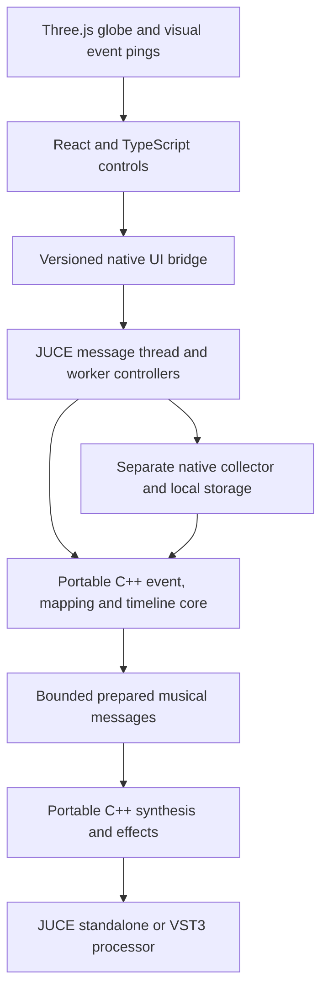

# Portable C++ core and React webview architecture

Decision recorded 6 November 2026 after the owner specified portable C++ and identified React or WebUI as UI possibilities. Direction H remains the visual reference. Another design agent owns the UI design; this work defines its native boundary, not a competing screen implementation.

The [revised build plan](BUILD_PLAN.md) is authoritative for delivery order and qualification. This document records the architecture milestone. Current repairs and open verification gates are in [the audit index](audits/AUDIT_AND_REVISED_BUILD_PLAN.md).

## Recommended arrangement

React and a webview solve different parts of the problem and can be used together. Use React/TypeScript for the two pages and control state, Three.js/WebGL for Direction H's globe, and JUCE's embedded browser as the desktop/plug-in UI container. The production collector, session/replay logic, mappings, region routing and DSP are portable C++. Keep JUCE-specific adapters thin.



The browser renders pictures and accepts user actions. It does not own sample-accurate timing, synthesis, collector polling, source credentials, SQLite or canonical session state. React does not itself provide 3D graphics; the renderer does that. Do not use Web Audio as a second authoritative sound engine.

If “WebUI” means the `webui-dev/webui` library, it is an alternative host/bridge for web content and can also host React. It is not a replacement for React's component model or the 3D renderer. Treat it as a possible standalone shell only; the preferred common standalone/VST3 UI host is JUCE's embedded browser. Do not adopt two host stacks without a concrete need.

## Current implementation and migration status

Implemented in this milestone:

- `atlas_core`: C++20 event types, explicit-timezone parsing, rational-speed replay, deterministic observation/arrival ordering and immutable prepared schedules. No JUCE, React, SQLite or Python dependency in this library.
- Caller-provided block output with no C++ allocation, I/O, locks or exceptions in `Timeline::block`. This is data-event scheduling, not synthesis yet. Construction and JSON/database access remain off the audio thread.
- `atlas_storage`: read-only schema-v2 SQLite adapter for existing saved sessions. It neither creates databases nor writes to the owner's collector library. Requires SQLite JSON functions.
- `atlas-native`: native session listing and replay-plan CLI. Uses C++ and SQLite at runtime; Python is only used as a development comparison oracle.
- A proposed TypeScript presentation/bridge contract in `ui/contracts.ts`. No live JUCE/React bridge is implemented yet; unsupported methods must stay disabled in prototypes.

The Python v0.2 collector/API remains the operational temporary reference, not the intended production dependency. The later audit repaired startup recovery ordering without touching any running process. Collector acquisition, write-side storage/session management, native session hash verification, service IPC, musical mapping, regional audio, DSP and JUCE wrappers remain to migrate/build. Do not describe the product as fully ported.

Existing SQLite schema and event identities are preserved. Replacing the writer requires cross-language baseline/deduplication/correction tests and a controlled handover, not running two writers against the same collection state. Do not interrupt an active recording to switch implementations.

## Native build and use

Requires a C++20 compiler, CMake 3.22+ and SQLite development headers/library. No paid dependency or network operation is part of configuring/building this target. On this Mac the installed Xcode SDK provides SQLite.

```sh
cmake -S . -B build/native -DCMAKE_BUILD_TYPE=Debug
cmake --build build/native -j 4
ctest --test-dir build/native --output-on-failure
build/native/atlas-native sessions --db .state/atlas.sqlite3
build/native/atlas-native replay --db .state/atlas.sqlite3 --session latest --mode observed --speed 60 --limit 5
```

Development-only parity check:

```sh
python3 -B tests/native_compatibility.py
```

The native CLI reads an existing library; it does not yet collect data, record sessions or make sound. Cryptographic session verification has not yet been ported: the native reader checks schema, structure, counts, field validity and capacity. The Python session code remains the checksum reference.

## UI integration contract for the design agent

Build the interface against an injected host adapter, not direct provider HTTP calls. `ui/contracts.ts` describes proposed DTOs and request/reply shapes independently of React/JUCE. It is a design integration contract, not an implemented RPC service.

- Same React views can use a clearly labelled mock adapter in a normal browser and a native adapter inside JUCE. Production code selects one authoritative host adapter.
- Fetch capabilities first. Unsupported source/history/audio/render functions show unavailable or disabled states; do not substitute invented live data.
- Session, voice, region and selection state should survive switching between Atlas and Sound Studio. Native state is authoritative; React may hold temporary edit/selection state.
- Marshal requests asynchronously on JUCE's message/worker threads. Validate sizes, types, identifiers, ranges and permissions natively before applying edits. No raw script evaluation built from provider text.
- Package HTML, JS, CSS, fonts, geometry and permitted textures locally. Use JUCE's resource provider/native event facilities after validating platform support. No required web server, Node process, CDN, sign-in or network texture service in the distributed application.
- Do not expose the current collector bearer token to browser code. The native host handles local IPC authentication. Existing Python loopback Origin rejection remains intact during the migration.
- Use strings for int64 revision IDs and microsecond values crossing JSON/JS boundaries. Convert only checked, bounded values to JavaScript numbers for view positioning.
- Keep visual updates batched and bounded. A map repaint must not emit one React state update per animal detection or become the audio timing source.
- A missed visual batch can be resynchronised from native state without retriggering musical notes. Reconnect uses durable store/cursor identity.
- Host automation and native state restore must update controls without a feedback loop that repeatedly reapplies the same parameter.
- Native file dialogs/render workers own file access. Do not expose arbitrary filesystem paths as an unrestricted bridge command.

## Direction H globe and performance requirements

Three.js is the proposed renderer, not a mandatory paid geographic service. Use properly licensed, bundled map geometry/textures and real coordinates. Generated mockup maps are not cartographic assets. An atmospheric rim, fixed-station pulses, selected-region outlines and restrained labels can establish the direction before expensive terrain/cloud layers.

Use instanced markers, bounded label/pulse pools and deliberate geometry/texture budgets. Keep animation separate from event ingestion. Pause or strongly throttle the globe when the editor is hidden, the Sound Studio is selected, or reduced-motion mode is active. Dispose GPU resources on UI teardown and handle context loss.

Test WebGL capabilities at runtime. Provide a legible 2D map fallback; missing graphics capabilities must not stop collection, audio or saved-session rendering. Consider a 30 fps target and a capped device pixel ratio as initial measurement settings, not verified performance claims.

JUCE uses platform browser engines. Validate WKWebView on macOS, select WebView2 explicitly on Windows, and test Linux's required WebKit environment separately. Do not accept an obsolete Windows browser fallback for this UI. Neither React nor a successful macOS build proves cross-platform WebGL or DAW host compatibility.

## Realtime and portability boundary

The portable core uses standard C++20 types and integer time. It avoids Objective-C, POSIX-only calls, compiler-specific 128-bit arithmetic and UI framework types. SQLite is isolated in the storage adapter; future networking is isolated behind an adapter. Platform-specific device, packaging and service-discovery code belongs outside the core.

Prepare replay data off-thread, then publish immutable native state with a lifecycle strategy that does not free memory or acquire locks in the callback. Keep note releases/panic independent of overload admission. The current event scheduler reports block omissions; rendering with different block sizes can select different surviving events under overload. Freeze musical action admission before rendering when overload partition invariance is required.

The native scheduler is not a complete realtime audio system: mapping, voice management, audio queues, processor lifetime/automation, tail handling and callback deadline qualification remain.

## Zero-cost and licensing constraint

React and Three.js have MIT licences. Retain their notices and choose other dependencies/assets with compatible zero-charge use. No paid map tiles, cloud rendering, proprietary data subscription or hosted account becomes a requirement.

JUCE offers AGPL and commercial licensing routes. A distribution model compatible with the owner's zero-cost requirement must be established before shipping a JUCE binary. This milestone adds no JUCE dependency or paid licence requirement; it does not decide the product's distribution licence on the owner's behalf.

## Validation and next gates

This milestone was built/tested on macOS arm64. C++ core tests cover timezone/calendar parsing, station identity, invalid positions, exact speed scaling, late batches, simultaneous ordering, sample partitions, seek boundaries, silence bounds, overflow and allocation-free block lookup. Native plans are compared against frozen real-data sessions with the Python oracle without opening the owner database writable.

Windows/MSVC, Linux, JUCE compilation, webview rendering, WebGL performance, DSP and actual DAW behaviour are untested. Portability describes the chosen language/interfaces and implementation discipline, not completed multi-platform qualification.

Revised next step: verify native session integrity and preservation, then prove one mapped native voice/offline render before completing the collector port. Add the protected UI boundary and local history workflow, backup/restore, then a controlled native writer handover. The detailed gates are M1–M5 in the canonical plan. Keep the working collection workflow until its replacements pass parity, durability and recovery checks.

## Official references checked

- [JUCE WebBrowserComponent and resource provider](https://docs.juce.com/master/classjuce_1_1WebBrowserComponent.html)
- [JUCE browser options and native integration](https://docs.juce.com/master/classjuce_1_1WebBrowserComponent_1_1Options.html)
- [React licence](https://github.com/react/react/blob/main/LICENSE)
- [Three.js documentation](https://threejs.org/docs/) and [licence](https://github.com/mrdoob/three.js/blob/dev/LICENSE)
- [WebUI alternative host](https://github.com/webui-dev/webui)
- [JUCE licence](https://github.com/juce-framework/JUCE/blob/master/LICENSE.md)
- [CMake SQLite discovery](https://cmake.org/cmake/help/latest/module/FindSQLite3.html)
