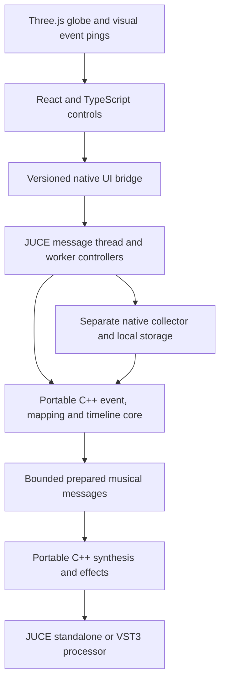

# Portable C++ core and React webview architecture

Decision recorded 6 November 2026 after the owner specified portable C++ and identified React or WebUI as UI possibilities. Direction H remains the visual reference. Another design agent owns the UI design; this work defines its native boundary, not a competing screen implementation.

The [revised build plan](BUILD_PLAN.md) is authoritative for delivery order and qualification. This document records the architecture milestone. Current repairs and open verification gates are in [the audit index](audits/AUDIT_AND_REVISED_BUILD_PLAN.md).

Beta 1 update, 7 November: [M1 data/session verification is complete](milestones/M1_VERIFIED_PIECE.md), including schema 3 metadata seals and historical windows. [M2 first-sound engineering](milestones/M2_FIRST_SOUND.md) supplies native numeric actions, bounded synthesis and offline WAV export. [Native UI saved-piece playback](milestones/UI_NATIVE_PLAYBACK.md) now connects explicit audio enable and transport to the same engine through an optional separate JUCE output executable; the [playback contract](milestones/NATIVE_PLAYBACK_CONTRACT.md) defines ownership, supported transitions and failure policy. The React UI still runs in a browser with a development bridge; a packaged JUCE webview remains future work. Human listening, device/recovery and whole-product qualification remain open, so whole M2 is not complete. [Frontend readiness](milestones/FRONTEND_INTEGRATION_READINESS.md) preserves the earlier data-only checkpoint; its audio-availability statements are superseded when the optional audio host advertises playback. [SQLite runtime requirements](milestones/BETA_1_NATIVE_INTEGRITY.md#sqlite-runtime-qualification) still apply.

## Recommended arrangement

React and a webview solve different parts of the problem and can be used together. Use React/TypeScript for the two pages and control state, Three.js/WebGL for Direction H's globe, and JUCE's embedded browser as the desktop/plug-in UI container. The production collector, session/replay logic, mappings, region routing and DSP are portable C++. Keep JUCE-specific adapters thin.



The diagram describes the target packaged arrangement. The current development route is browser React → bounded development bridge → serial native stdin worker → portable PlaybackRuntime → JUCE output callback. The output executable and browser UI are separate processes; no packaged webview is claimed.

The browser renders pictures and accepts user actions. It does not own sample-accurate timing, synthesis, collector polling, source credentials, SQLite or canonical session state. React does not itself provide 3D graphics; the renderer does that. Do not use Web Audio as a second authoritative sound engine.

If “WebUI” means the `webui-dev/webui` library, it is an alternative host/bridge for web content and can also host React. It is not a replacement for React's component model or the 3D renderer. Treat it as a possible standalone shell only; the preferred common standalone/VST3 UI host is JUCE's embedded browser. Do not adopt two host stacks without a concrete need.

## Current implementation and migration status

Current implemented boundary:

- `atlas_core`: C++20 event types, explicit-timezone parsing, rational-speed replay, deterministic observation/arrival ordering and immutable prepared schedules. No JUCE, React, SQLite or Python dependency in this library.
- Caller-provided block output with no C++ allocation, I/O, locks or exceptions in `Timeline::block`. This function remains data-event scheduling; synthesis is implemented separately in `atlas_audio`. Construction and JSON/database access remain off the audio thread.
- `atlas_storage`: read-only schema-v2/v3 SQLite adapter with native content/metadata verification for existing saved sessions. It neither creates databases nor writes to the owner's collector library. Requires SQLite JSON functions.
- `atlas_audio`: immutable numeric plans, absolute-window admission, eight primary/eight retiring voice states, finite additive tone and single-owner transport. Plan preparation/destruction stay on the worker; the renderer borrows its stable plan. This first experiment does not cap the complete instrument.
- `atlas-native`: session listing, replay and offline `render` CLI with 24-bit stereo WAV and embedded recipe, exclusive no-overwrite publication. Uses C++ and SQLite at runtime; Python is a development oracle, not a second production audio engine.
- `atlas_playback`: portable runtime with one serial control worker, one callback, a single-entry command mailbox and atomic transport snapshots. Device stop establishes quiescence before worker-owned renderer/plan replacement and retirement. Explicit enable never autoplays; stale IDs/generations, callback faults, timeout and lease expiry remain observable.
- Optional `atlas-audio-host`: a separate JUCE application with main-thread device lifecycle and a serial stdin worker, using an existing local JUCE checkout. It opens stereo output without input capture. The default `atlas-native ui-host` remains data-only. Neither executable is a packaged React webview or VST3.
- React/native presentation and saved-piece playback through the development bridge are implemented. Capability-backed `getTransport`, `setTransport`, `getAudioState` and `setAudioEnabled` use acknowledged native state; UI polling does not extrapolate audio time. The fixed first voice plays at -18 dB. Live sonification, voice editing, effects, runtime master gain and UI render jobs remain unsupported, while offline CLI WAV export is retained. See the linked playback milestone for current contract ownership.

The Python collector/API remains the operational temporary reference, not the intended production dependency. The later audit repaired startup recovery ordering without touching any running process. Collector acquisition, write-side storage/session management, service IPC, richer mappings/modulation, regional audio, packaged JUCE webview and VST3 wrappers remain to migrate/build. Native session hash verification, first-voice/WAV and experimental native saved-piece playback are implemented; device/recovery qualification is still in progress. Do not describe the product as fully ported.

Existing SQLite schema and event identities are preserved. Replacing the writer requires cross-language baseline/deduplication/correction tests and a controlled handover, not running two writers against the same collection state. Do not interrupt an active recording to switch implementations.

## Native build and use

Requires a C++20 compiler, CMake 3.22+ and SQLite development headers/library. No paid dependency or network operation is part of configuring/building this target. On this Mac use the qualified Homebrew SQLite headers/library documented in the linked runtime notes; the system runtime failed the closed-WAL fixture.

```sh
cmake -S . -B build/native -DCMAKE_BUILD_TYPE=Debug
cmake --build build/native -j 4
ctest --test-dir build/native --output-on-failure
build/native/atlas-native sessions --db .state/atlas.sqlite3
build/native/atlas-native replay --db .state/atlas.sqlite3 --session latest --mode observed --speed 60 --limit 5
```

Development-only parity check:

```sh
python3 -B tests/native_compatibility.py
```

The `atlas-native` CLI reads verified saved material and renders native synthesis to WAV; it does not collect, record sessions or open an audio device. The separate optional `atlas-audio-host` owns device output and accepts the playback UI requests described above. SHA-256 event content and metadata seals are verified in a consistent read snapshot before preparation/rendering. Final Debug and ASan+UBSan runs pass eight CTest suites each, and the optional Release audio-host build passes nine suites, including 13 runtime and nine protocol groups. An independent ThreadSanitizer run passes all 13 runtime groups. See [playback evidence](../evidence/native-playback/) for commands and identities; `evidence/m2-audio/final-*` retains the earlier offline checkpoint. A separate real-JUCE prepare-only regression checks native application preparation/shutdown without enabling output. A [brief actual default-output callback smoke](../evidence/native-playback/device-smoke.json) passed at 48 kHz/-18 dB after real-host startup and device-list-policy repairs, covering silent enable, advancing position, pause/seek/resume/stop and clean EOF shutdown. The receipt does not establish heard audio, owner-approved sound, device-change/recovery behavior, sustained operation or callback deadlines.

## UI integration contract for the design agent

Build the interface against an injected host adapter, not direct provider HTTP calls. `ui/contracts.ts` defines shared DTOs independently of React/JUCE. The optional audio host implements saved-piece transport and audio-enable methods alongside the existing read-only data methods; other proposed editing, effects, master-gain and render-job interfaces remain capability-gated and unavailable. The data-only host continues to advertise `audioAvailable:false`.

- Same React views can use a clearly labelled mock adapter in a normal browser and a native adapter inside JUCE. Production code selects one authoritative host adapter.
- Fetch capabilities first. Unsupported source/history/audio/render functions show unavailable or disabled states; do not substitute invented live data.
- Session, voice, region and selection state should survive switching between Atlas and Sound Studio. Native state is authoritative; React may hold temporary edit/selection state.
- Marshal requests asynchronously on JUCE's message/worker threads. Validate sizes, types, identifiers, ranges and permissions natively before applying edits. No raw script evaluation built from provider text.
- Package HTML, JS, CSS, fonts, geometry and permitted textures locally. Use JUCE's resource provider/native event facilities after validating platform support. No required web server, Node process, CDN, sign-in or network texture service in the distributed application.
- Do not expose the current collector bearer token to browser code. The native host handles local IPC authentication. Existing Python loopback Origin rejection remains intact during the migration.
- Use strings for int64 revision IDs and microsecond values crossing JSON/JS boundaries. Convert only checked, bounded values to JavaScript numbers for view positioning.
- Keep visual updates batched and bounded. A map repaint must not emit one React state update per animal detection or become the audio timing source.
- A missed visual batch can be resynchronised from native state without retriggering musical notes. Reconnect uses durable store/cursor identity.
- Host automation and native state restore must update controls without a feedback loop that repeatedly reapplies the same parameter.
- Native file dialogs/render workers own file access. Do not expose arbitrary filesystem paths as an unrestricted bridge command.

## Direction H globe and performance requirements

Three.js is the proposed renderer, not a mandatory paid geographic service. Use properly licensed, bundled map geometry/textures and real coordinates. Generated mockup maps are not cartographic assets. An atmospheric rim, fixed-station pulses, selected-region outlines and restrained labels can establish the direction before expensive terrain/cloud layers.

Use instanced markers, bounded label/pulse pools and deliberate geometry/texture budgets. Keep animation separate from event ingestion. Pause or strongly throttle the globe when the editor is hidden, the Sound Studio is selected, or reduced-motion mode is active. Dispose GPU resources on UI teardown and handle context loss.

Test WebGL capabilities at runtime. Provide a legible 2D map fallback; missing graphics capabilities must not stop collection, audio or saved-session rendering. Consider a 30 fps target and a capped device pixel ratio as initial measurement settings, not verified performance claims.

JUCE uses platform browser engines. Validate WKWebView on macOS, select WebView2 explicitly on Windows, and test Linux's required WebKit environment separately. Do not accept an obsolete Windows browser fallback for this UI. Neither React nor a successful macOS build proves cross-platform WebGL or DAW host compatibility.

## Realtime and portability boundary

The portable core uses standard C++20 types and integer time. It avoids Objective-C, POSIX-only calls, compiler-specific 128-bit arithmetic and UI framework types. SQLite is isolated in the storage adapter; future networking is isolated behind an adapter. Platform-specific device, packaging and service-discovery code belongs outside the core.

Prepare replay data off-thread. M2 compiles immutable musical actions with absolute-window admission, so offline audio is partition-independent under overload; the older `Timeline::block` data lookup separately reports caller-capacity omissions. M2 has one owner and a renderer borrowing a stable plan, with finite releases and panic independent of note admission. The implemented PlaybackRuntime establishes callback quiescence through driver stop before replacing/retiring plans on the control worker. Its one-command mailbox and atomic snapshot make control execution and actual callback position visible without transferring owning plans to the callback. Seamless plan swaps, automation and richer graph publication remain future work.

The engine has a bounded voice pool, finite tails, tested controls and synthetic process timing. The playback runtime adds tested mailbox/snapshot/lifetime ownership and UI integration, including exact PCM parity with the existing renderer across callback partitions, fault silence and timeout/lease recovery. Fake-driver and race tests do not qualify the JUCE/CoreAudio device path. Hardware lifecycle/recovery, sustained callback deadlines, automation and whole-product UI/GPU/audio load remain open.

## Zero-cost and licensing constraint

React and Three.js have MIT licences. Retain their notices and choose other dependencies/assets with compatible zero-charge use. No paid map tiles, cloud rendering, proprietary data subscription or hosted account becomes a requirement.

JUCE offers AGPL and commercial licensing routes. A distribution model compatible with the owner's zero-cost requirement must be established before shipping a JUCE binary. The portable core/runtime and default build remain independent of JUCE. The optional output executable reuses an existing pinned JUCE checkout, with no automatic download or required purchase for the local engineering work. Its licence and the no-cost distribution route are recorded in the [playback contract](milestones/NATIVE_PLAYBACK_CONTRACT.md); this integration does not decide the product's distribution licence or establish closed-source redistribution permission.

## Validation and next gates

The current engineering slice was built/tested on macOS arm64. Historical architecture-milestone checks below are retained as earlier evidence, not a claim of current owner-library inspection. C++ core tests cover timezone/calendar parsing, station identity, invalid positions, exact speed scaling, late batches, simultaneous ordering, sample partitions, seek boundaries, silence bounds, overflow and allocation-free block lookup. Native plans are compared against frozen real-data sessions with the Python oracle without opening the owner database writable.

Offline tone DSP has equation, numerical, transition, allocation, partition and sanitizer evidence. The native playback runtime adds 13 hardware-free groups, nine real-runtime protocol groups and a passing ThreadSanitizer run. The macOS JUCE output executable builds and has a passing brief actual device callback smoke; device-change/recovery qualification, sustained load and owner listening remain open. Windows/MSVC, Linux, embedded webview rendering, complete-product WebGL/audio resource load and actual DAW behaviour remain unqualified. Portability describes the chosen language/interfaces and implementation discipline, not completed multi-platform qualification.

Current next gates: extend the brief actual device smoke to device-change/recovery and sustained-load qualification, obtain owner listening decisions on the existing corpus/playback, measure whole-product CPU/GPU/audio load, and package/qualify the desktop webview and supported platforms. Capability-backed UI transport and native ownership are implemented; their engineering evidence does not close these acceptance gates. Extend local history/piece save-reopen and backup/restore, then qualify a controlled native writer handover. Retain the acoustic stream while prioritising evidenced individual-animal tracking; [offline pilots](../data-pilots/REVIEW.md) are not active sources and GBIF occurrences remain optional/deferred. The detailed gates are M1–M5 in the canonical plan. Keep the working collection workflow until its replacements pass parity, durability and recovery checks.

## Official references checked

- [JUCE WebBrowserComponent and resource provider](https://docs.juce.com/master/classjuce_1_1WebBrowserComponent.html)
- [JUCE browser options and native integration](https://docs.juce.com/master/classjuce_1_1WebBrowserComponent_1_1Options.html)
- [React licence](https://github.com/react/react/blob/main/LICENSE)
- [Three.js documentation](https://threejs.org/docs/) and [licence](https://github.com/mrdoob/three.js/blob/dev/LICENSE)
- [WebUI alternative host](https://github.com/webui-dev/webui)
- [JUCE licence](https://github.com/juce-framework/JUCE/blob/master/LICENSE.md)
- [CMake SQLite discovery](https://cmake.org/cmake/help/latest/module/FindSQLite3.html)
