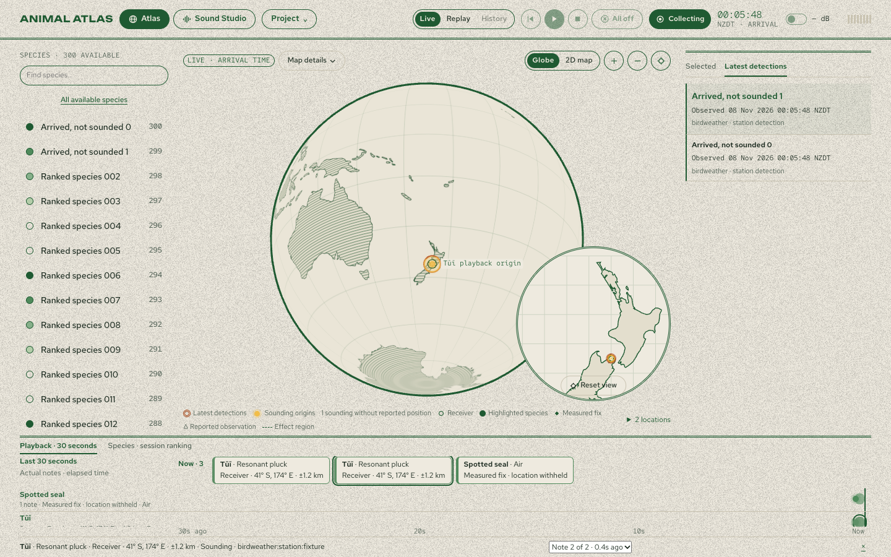

# Time ribbon · 0.11.0

The image shows the working interface with synthetic species and detection records. The bottom tabs switch between the last 30 seconds of confirmed playback and the full session ranking.

The packaged Apple Silicon app ran a collection and listening session against a disposable database and a virtual stereo output. Its native audio callback started 501 notes. A sparse test note identified the species, “Struck tone” voice and receiver at 41° S, 174° E. The map and ribbon used the same note ID; the test observed the point sounding, fading and disappearing while the earlier note could still be inspected. A delayed observation from before Collect stayed out of Live. The separate ranking stayed in descending order after a 500-detection burst. No pending, grouped or dropped notes remained in this Smoothed run.

All 44 native release suites and 100 UI tests passed. Browser fixtures covered Atlas and Sound Studio at 1440 × 900 and 1280 × 800, including keyboard selection and overlapping notes. Native tests covered voice stealing and shortened envelopes. Map checks covered shared receivers, fade after the last note, selected history and undisclosed coordinates.

Both the local release and the extracted ZIP passed macOS code signature verification and matched file for file. This test used a virtual output and made no provider requests; it did not verify physical speakers or a live provider connection. See the [release record](release.json) for the binary source identity, ZIP digest and measured results.
